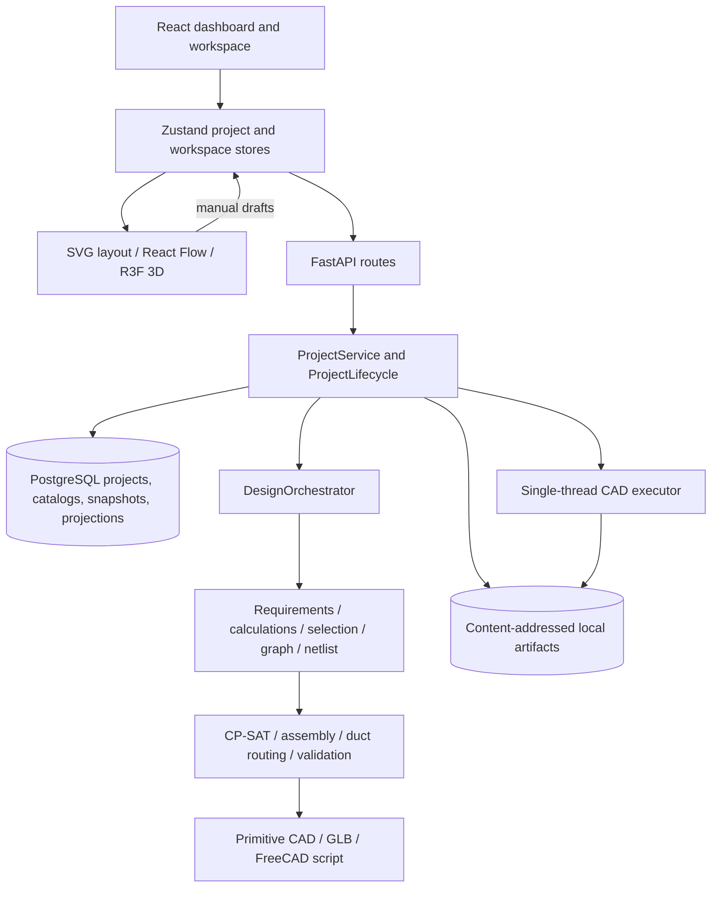
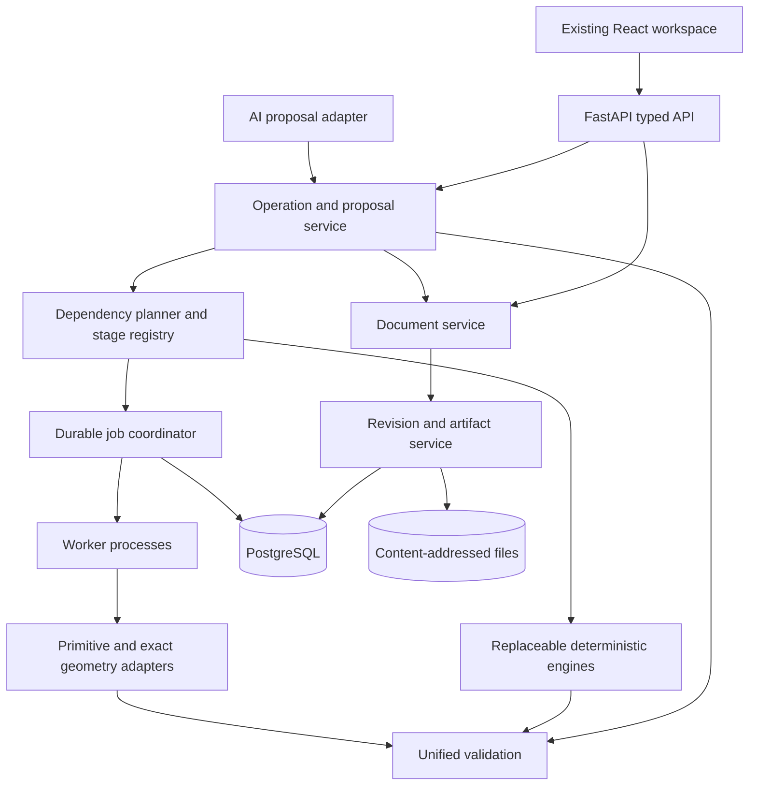
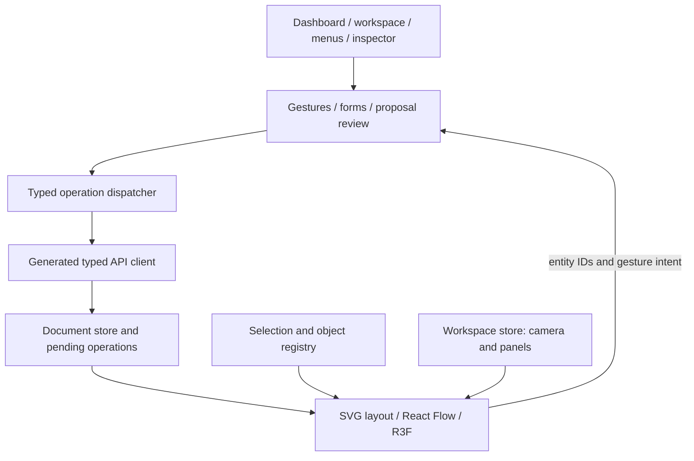
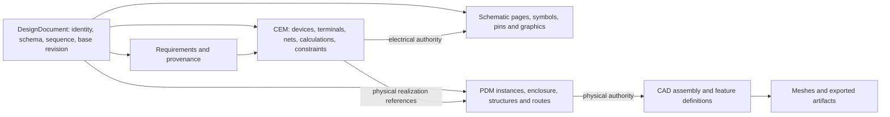
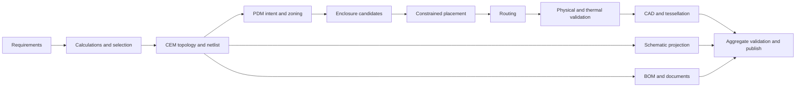
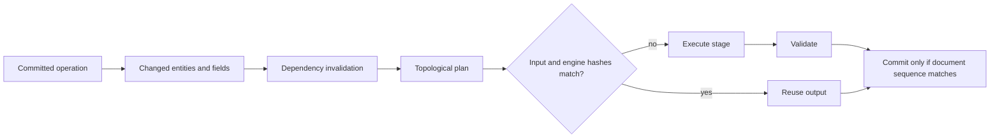
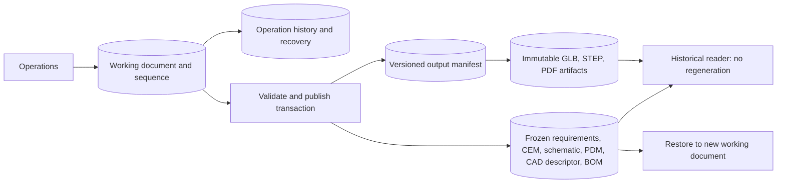

# PanelFlow Architectural Assessment and Implementation Plan

**Assessment date:** 6 November 2026. **Scope:** Source-based assessment and planning; no application implementation. **Authorized output:** This report only. Existing source and pre-existing working-tree changes were preserved.

## 1. Executive Summary

PanelFlow already has a substantial distribution-board design prototype: a React/TypeScript CAD-style workspace, FastAPI modular backend, typed CEM/PDM models, PostgreSQL persistence, versioned catalogs, atomic revision publication, content-addressed artifacts, CP-SAT placement, duct routing, schematic generation, editable draft views, and recovery checkpoints. These foundations should be evolved rather than replaced.

The central architectural problem is **the separation between generated engineering revisions and manual editor drafts**. Generation creates authoritative CEM/PDM snapshots. Manual placement and schematic changes are saved mainly as workspace data outside those snapshots. A saved manual layout therefore does not become the geometry exported from the engineering revision. AI assistance would inherit this inconsistency unless a common document and operation boundary is introduced first.

Other decisive findings:

- Historical CEM/PDM snapshots and stored artifacts have hashes, but `ProjectService.load_revision()` rebuilds schematic data, CAD primitives, and BOM using current code. Historical output fidelity is incomplete.
- Change propagation reports affected stages after full generation; it is not an incremental scheduler. Stored dependency rows are provenance, not executable dependencies.
- Validation is meaningful but bounded. Selection contains fixed feeder patterns, calculations contain fixed assumptions, physical checks primarily use footprints/envelopes, and wire geometry can have overall `PASS` with engineering subchecks `UNRESOLVED`. Generation is not comprehensive engineering approval.

**Recommendation:** Retain the modular monolith, PostgreSQL, React/Zustand, Three.js, React Flow, and existing algorithms. Add an authoritative working document, transactional operations, complete revision outputs, dependency scheduling and durable jobs. Extend the primitive CAD adapter through a tested geometry-worker interface. Add AI through validated proposals using the same operations.

| Additional delivery scope | Developer hours | Eight-hour days | Forty-hour weeks |
|---|---:|---:|---:|
| Minimum viable document-centric DB editor | 880–1,360 | 110–170 | 22–34 |
| Recommended bounded professional DB application, including basic AI | 2,080–3,280 | 260–410 | 52–82 |
| Broader domain-specific target | 3,280–5,680 | 410–710 | 82–142 |

These include implementation, tests, integration and documentation, but are not calendar promises. The full scope is a domain-specific panel application, not AutoCAD/SolidWorks feature parity. Catalog procurement, standards access, independent engineering approval and unrestricted archetype expansion can add substantial work.

Approximate architectural coverage is **35–45%, with a central judgment of about 40%**. This is architectural coverage, not a measured completion or remaining-effort metric. UI and storage are more mature than shared commands, incremental execution, professional engineering analysis, and AI.

### Evidence method and limits

Repository inventory, executable source, API routes, models, migrations, algorithm bodies, UI state paths and test implementations were inspected. Documentation was not used as proof that features exist. References use repository-relative links and named symbols; cited line numbers identify entry points and may change later.

No build, application launch, test execution, database migration, dependency installation or CAD export execution was performed. PostgreSQL integration fixtures create/drop a database, so they were inspected rather than invoked during this read-only assessment. Test presence demonstrates intended coverage, not passing status. Dependency compatibility, deployed database roles, runtime performance, packaged desktop behavior and actual FreeCAD/STEP execution remain **UNVERIFIED**.

The repository was inventoried as a whole. Detailed inspection focused on application source and relevant tests. Binary documents/images, dependency internals, every generated ORM declaration and every branch of the large routing module were not exhaustively audited. This is not formal code certification. No applicable `AGENTS.md` was found. Pre-existing changes included `frontend/src/components/loading/LoadingPage.tsx` and untracked documents; none was edited.

## 2. Existing Project Architecture

### 2.1 Repository and evidence map

| Area | Implementation inspected |
|---|---|
| Frontend/screens | `frontend/src/App.tsx`, `MainApp.tsx`, `pages/ProjectDashboard.tsx`, `pages/ProjectPage.tsx`, workspace components |
| State/recovery | [projectStore.ts](frontend/src/stores/projectStore.ts), `workspaceStore.ts`, `projectRecovery.ts`, `hooks/useProjectRecovery.ts` |
| Transport/readiness | [client.ts](frontend/src/api/client.ts), `api/config.ts`, `api/backend.ts` |
| Backend/API | [main.py](backend/app/main.py), `api/dependencies.py`, `api/routes_*.py` |
| Application services | [project_service.py](backend/app/services/project_service.py), [project_lifecycle.py](backend/app/services/project_lifecycle.py), [orchestrator.py](backend/app/services/orchestrator.py) |
| Models | `backend/app/models/{requirements,cem,pdm,electrical_graph,api}.py`; frontend `src/types` |
| Engineering | Requirement/calculation/selector/graph/netlist/schematic/enclosure/assembly/validation/CAD/wire services |
| Algorithms | CP-SAT placement, layout configuration, duct routing, schematic routing, selected JPS/Theta* internals |
| Persistence | `persistence/{database,config,repositories,revisions,assets,parameters,models}.py`; migrations/baseline SQL; seed/import entry points |
| Libraries | JSON fixtures for components/enclosures/templates/rules/hardware; database catalog adapter and legacy repositories |
| Tests | Backend pipeline/PostgreSQL/lifecycle/constraint/wire/assembly/questionnaire tests; frontend store/editor/recovery/workspace/API tests |
| Build/deployment | `frontend/package.json`, Vite config, Tauri config/Rust launcher, `backend/requirements.txt`, `desktop_main.py`, PyInstaller spec |

### 2.2 Current architecture



This is a modular application with synchronous design generation and a small asynchronous export path, not a distributed system.

### 2.3 Frontend modules

`ProjectDashboard` provides project lifecycle/navigation. `ProjectPage` composes menus, toolbar, browser, docked inspector, tabs, bottom panels and revision dialogs. Retain this shell.

`projectStore.ts` combines requirements, CEM/PDM/baseline PDM, schematic/CAD payloads, selection, transforms/history, network operations, revisions, recovery and polling. `workspaceStore.ts` separately persists dock dimensions/visibility. That separation is useful, but the 474-line project store still mixes several responsibilities.

- `Layout2DViewer.tsx`: SVG footprints/routes/zones, dragging, snapping, numeric transforms, alignment and rotation.
- `Panel3DViewer.tsx`: React Three Fiber scene, selection, transform tools, navigation and exploded display. `PanelAssembly.tsx` renders assembly primitives/wires.
- `AssetObject.tsx`: cached GLB loading, cloned scenes and fallback/error display.
- `SchematicViewer.tsx`: React Flow symbols, terminal handles, editable edges/junctions and local checks. It explicitly labels edits as drafts that do not alter CEM.
- `useWorkspaceCommands.ts`: action/keyboard bindings, not a transactional engineering command manager.
- Inspector/browser/shared selection IDs provide useful cross-view foundations, but no complete typed object registry or general multi-selection operation model exists.

Undo/redo stores transform snapshots, capped at 100 undo entries. It does not cover requirements, component insertion/removal, connections, schematic edits, enclosure changes or durable operation history.

### 2.4 Traced end-to-end workflow

1. Frontend waits for `/ready`, which depends on PostgreSQL and the expected migration head.
2. `POST /api/projects` calls `ProjectService.create()`: resolve template, validate requirements, save project and requirement provenance.
3. Questionnaire choices are constrained by `questionnaire_choices.py` against selector/router capabilities. Suggestions are deterministic, not AI.
4. `saveCurrentProject()` sends requirements/configuration/workspace drafts through project PATCH with expected project/recovery versions.
5. `runDesignPipeline()` normally creates a revision. `ProjectService._inputs()` reads pinned catalogs/rules/model references, then closes the session before heavy computation.
6. `DesignOrchestrator.generate_design()` validates requirements; computes estimates; selects devices; creates graph/netlist/schematic; tries enclosure candidates; solves placement; builds ducts/routes; validates; produces CAD/BOM.
7. `generate_files()` writes GLB/script blobs. `write_revision()` atomically writes snapshots, relational projections, validation, dependencies, provenance and artifact metadata, checking the project version before advancing its revision pointer.
8. `load_revision()` verifies hashes and returns snapshots plus freshly reconstructed schematic/CAD/BOM. Frontend initializes viewers.
9. Moving a component updates `editorTransforms`, clears routes and builds a draft PDM from its baseline. The client function `validatePlacement()` actually calls `/design/reroute-placement`. Backend uses saved CEM connectivity and returns `persisted: false`.
10. Save preserves transforms in workspace JSON. Later generation builds a new placement and clears workspace through `write_revision()`. No general operation publishes the edited PDM as the next engineering revision.

Entry points: `projectStore.ts:193`, `:251`, `:365`, `:410`; `project_service.py:132`, `:171`, `:177`; `orchestrator.py:57`; `persistence/revisions.py:16`.

### 2.5 API contracts

| Endpoint family | Implemented responsibility | Limit |
|---|---|---|
| `/api/projects`, `/{id}` | Create/list/search/update/tombstone | Project versioning, no engineering operation contract |
| `/open`, `/duplicate`, `/export`, `/import` | Lifecycle/version-1 JSON package | Artifact bytes omitted; import regenerates artifacts and needs compatible catalogs |
| `/answers`, `/requirements`, questions/validate/suggestions | Saved answers, templates and deterministic suggestions | DB-oriented requirement scope |
| `/revisions`, `/{rid}`, `/restore` | Generate/publish/read/restore as new revision | No durable mutable engineering document; some outputs rebuilt |
| `/design/generate`, `/design/propagate-change` | Full generation; generate then compare | Optional expected version on alternate paths; no preview-before-commit |
| `/design/validate-placement` | Validate submitted PDM | Does not load authoritative CEM or server-owned dimensions/policy |
| `/design/reroute-placement` | Reroute draft against current saved CEM | ID-set check, no explicit base revision precondition; not persisted |
| `/layout`, `/schematic`, `/cad` | Saved design projections | All depend on `load_revision()` |
| `/cad-generation`, `/{job}` | GLB/script queue/status | In-process execution, despite persistent status |
| `/assets`, `/artifacts` | Metadata and hash-verified downloads | Serving path supports local storage |
| `/components`, `/enclosures`, `/archetypes` | Versioned library access | Does not provide arbitrary component editing |

### 2.6 Sources of truth

| Representation | Current authority | Consequence |
|---|---|---|
| Saved requirements/configuration | PostgreSQL project/requirement records | May differ from last generated revision |
| Generated CEM | Hashed CEM JSON snapshot | Relational instances/terminals/nets are parallel projections |
| Generated PDM | Hashed PDM JSON snapshot | Relational placement/route/structure projections also exist |
| Manual physical arrangement | Frontend transforms/draft PDM; workspace JSON on Save | Outside revision/export authority |
| Electrical connectivity | Generated CEM nets/connections | Schematic draft connection changes do not update it |
| Schematic graphics | Current generator or workspace draft | No independent revisioned schematic document |
| CAD | Primitive descriptor derived from PDM; stored GLB/script | No resident exact solid/feature model |
| BOM | Backend `assembly_bom()`; frontend reconstructs display rows | Risk of output/display drift; not frozen as separate output |
| Catalog/rules | Published PostgreSQL versions in API workflow | JSON repositories remain default engine/test adapters |
| Display preferences | Local UI state/Zustand persistence | Appropriate display-only authority |

### 2.7 Persistence and history

SQLAlchemy/Alembic and PostgreSQL are already implemented. `ProjectRepository.check_version()` locks a project row and rejects stale versions; revision publication is transactional. Computation runs outside the write transaction and is fenced by a final version check.

`AssetStore.put()` uses SHA-256 keys, temporary writes, flush/fsync and atomic replacement. `verified_path()` checks path containment, length and hash. A failed database publication after blob creation can leave orphaned blobs; add reachability-based garbage collection.

Immutability is application repository policy, not a demonstrated universal database trigger. `0001_baseline.sql` explicitly names repository policy and production DB roles; deployed roles were not verified. Hashes detect corruption but do not prevent writes.

Recovery already exists: local checkpoints, 1.5-second debounced server saves, project/recovery version checks, base-revision metadata and recovery prompts. Server recovery documents are capped at 4 MiB. Adapt this to the new document rather than rebuild it.

### 2.8 Engineering and CAD reality

`CalculationEngine` computes seven deterministic DB estimates with fixed diversity 0.75, busbar multiplier 1.25, empirical conductor current density, and fixed equivalent length/resistance for voltage drop. These are code assumptions, not comprehensive load/protection/cable analysis.

`ComponentSelector` filters some parts by ratings but picks outgoing breakers in a repeating 16 A/32 A/40 A pattern and fixes several terminal/bar products. Graph/netlist generators are DB-specific. `NetlistEngine` mainly derives connectivity from roles rather than an arbitrary input graph. Multiple named nets share a busbar terminal: equipotential-net versus conductor-segment semantics need clarification before general electrical editing.

CP-SAT provides real bounds/non-overlap, rail/duct restrictions, soft wire/heat/zoning objectives, feasibility results and independent checks. It tries row counts and enclosure candidates; it is not general 3D placement or guaranteed globally optimal panel design.

The active router is `DuctRouter` using Manhattan A* and inherited geometry helpers. The existence of `JPSThetaStarRouter` does not establish that current generation uses JPS/Theta* for all routes. Duct routing has 56 discrete conductor lanes and generic insulation-diameter fallbacks. Draft rerouting explicitly rejects rotated devices.

`ValidationEngine` checks footprint collision/clearance, bounds/depth, thermal density, references, route endpoints and duct containment/fill. Its component polygons ignore `rotation_deg`. `wire_geometry.py` additionally checks sampled curved-wire envelopes in 3D against boxes. Its overall geometry status can be `PASS` while bend data, segregation, conductor dimensions or virtual earth anchor remain unresolved.

`CADEngine` produces boxes/cylinders/tubes/envelopes. `export_freecad_script()` emits `Part::Feature` objects and a STEP export statement; the backend does not execute FreeCAD or produce verified STEP. Emitted script capability is not an implemented STEP service.

### 2.9 AI, testing and deployment

No executable LLM integration was found in source/dependencies. AI study documents are not implementation. Deterministic questionnaire suggestions provide a useful seed for later assistance.

Pytest/Vitest tests cover pipeline identity, invalid requirements, geometry/routing, GLB, recovery, conflicts, rollback and lifecycle. PostgreSQL tests require `PANEL_RUN_POSTGRES_TESTS=1`; ordinary runs may skip persistence coverage. Passing status is unverified.

FastAPI has structured errors, health/readiness and origin restrictions. No authenticated user/role boundary was observed. Tauri starts a localhost sidecar and drains/discards process events. Build configuration exists, but no CI pipeline was found. Clean-machine provisioning and packaging need verification. `panel-backend.spec` has `datas=[]`, an audit flag rather than proof of failure.

## 3. Current Architecture vs Target Architecture

IMPLEMENTED means concrete bounded behavior is present in source, not runtime certification. PARTIALLY IMPLEMENTED means substantial gaps remain. TECHNICAL DEBT identifies behavior conflicting with the target. MISSING means no implementation found. UNVERIFIED requires runtime/external evidence.

| Architectural area | Current implementation/status | Target requirement | Gap | Required action |
|---|---|---|---|---|
| Dashboard/lifecycle | IMPLEMENTED | Project/document UX | Project-centric, not document lifecycle | Retain and extend |
| Workspace/inspector | IMPLEMENTED | CAD workspace | UI callbacks lack transactions | Bind shared operations |
| Selection/multi-view | PARTIALLY IMPLEMENTED | Typed synchronized selection | Ad hoc ID conversion | Object registry/selectors |
| Working document | MISSING | Shared manual/auto/AI model | Draft/revision split | Document aggregate |
| Commands/transactions | MISSING for domain | Atomic validated operations | UI actions only | Registry/service/log |
| Undo/redo | PARTIALLY IMPLEMENTED | All supported engineering edits | Transforms only | Semantic inverse/history |
| Requirements | PARTIALLY IMPLEMENTED | Loads/environment/ambiguity/review | Narrow template | Extend data and workflow |
| CEM | PARTIALLY IMPLEMENTED | Complete engineering authority | Loads/constraints/compliance largely unpopulated | Implement semantics |
| Stable IDs | PARTIALLY IMPLEMENTED | Identity across arbitrary edits | Sequence keys; regenerated relational UUIDs | Logical UUIDs vs labels |
| Schematic | TECHNICAL DEBT | Revisioned graphics grounded in CEM | Draft wires outside CEM | Typed model/connection commands |
| PDM/editing | TECHNICAL DEBT | Authoritative physical edits | Export excludes draft | Commit working PDM |
| Parametric CAD | PARTIALLY IMPLEMENTED | Assembly/features/exact geometry | Primitives/parameter evaluator only | Kernel adapter/feature model |
| Visualization | IMPLEMENTED for current geometry | Picking/navigation/rendering | No full CAD editing | Preserve and extend |
| STEP/import | MISSING executed service | Verified interoperability | Script emission only | Worker/round-trip tests |
| GLB | IMPLEMENTED | Revision-bound previews | Draft excluded | Document-bound export |
| Persistence | IMPLEMENTED | Durable projects | No working engineering aggregate | Extend schema |
| Revisions/history | TECHNICAL DEBT | Exact historic outputs | Live reconstruction; roles unverified | Complete frozen outputs |
| Autosave/recovery | PARTIALLY IMPLEMENTED | All document edits | Overlay-oriented | Operation/document checkpoints |
| Dependencies | PARTIALLY IMPLEMENTED | Executable graph | Static report/provenance | Stage registry |
| Incremental regeneration | MISSING | Affected stages only | Full rerun | Invalidation/cache scheduler |
| Stale detection | PARTIALLY IMPLEMENTED | Per-output validity | Non-current/history conflated | Separate freshness concepts |
| Jobs | TECHNICAL DEBT | Durable execution | Executor/restart-wide failure | Leased jobs/workers |
| Concurrency | PARTIALLY IMPLEMENTED | Safe operations and jobs | No idempotency/base-bound reroute | Mandatory sequences/fencing |
| Unified validation | PARTIALLY IMPLEMENTED | Consistent status/evidence | Unresolved aggregation missing | Release gate |
| AI | MISSING | Structured assistance | No service | Add after commands |
| Testing/CI | PARTIALLY IMPLEMENTED | Reproducible complete acceptance | DB opt-in; kernel/E2E gaps | Dedicated CI lanes |
| Deployment/security | UNVERIFIED readiness | Installable trusted product | No verified package/auth/restore | Deployment-specific hardening |

### All 18 engineering responsibilities

Proposed inputs/outputs below are target contracts, not claims of existing interfaces. All currently have PARTIALLY IMPLEMENTED coverage; most are narrow DB algorithms rather than general engines.

| # | Responsibility and implementation evidence | Proposed inputs → outputs | Required change |
|---:|---|---|---|
| 1 | Requirement engineering: `requirement_engine.py` | Answers/template/context → normalized states/issues/questions | Loads/environment/uncertainty and approval |
| 2 | Knowledge/rules: persistence rules + layout policy | Versioned rules/facts → applicable decisions/evidence | Move hardcoded methods behind rule interfaces |
| 3 | Calculations: `calculation_engine.py` | Loads/supply/environment → typed quantities | Approved methods/units/applicability |
| 4 | Selection: `component_selector.py` | Calculations/constraints/catalog → candidates/selection reasons | Remove fixed feeder mix |
| 5 | Functional graph: `graph_engine.py` | Modules/devices/intent → topology | General role instances/editability |
| 6 | Netlist: `netlist_engine.py` | Topology/terminal equivalence → nets/conductors/ERC | Correct net versus segment semantics |
| 7 | Auto schematic: `schematic_engine.py` | CEM/symbols/constraints → graphical model | Pages/cross-references/manual positions |
| 8 | PDM generation: orchestrator | CEM/mechanical policy → instances/mounting intent | Durable identity/manual constraints |
| 9 | Zoning: zoning/layout configuration | Roles/separation/enclosure → zones/constraints | Integrate preferences and hard separation |
| 10 | Enclosure: `enclosure_engine.py` | Envelope/IP/thermal demand → candidates | Better evidence, IP semantics, overrides |
| 11 | Placement: CP-SAT | Instances/enclosure/hard constraints → feasible placement | Fixed/manual positions/orientations |
| 12 | Optimization: CP-SAT objective | Feasible designs/objectives → alternatives/metrics | Explicit optimality/limits; never relax hard rules |
| 13 | Routing: duct router | Netlist/PDM/conductor specs → validated routes | Real dimensions/bends/segregation/capacity |
| 14 | Thermal: validator/enclosure screen | Loss/environment/enclosure → estimate/issues | W/L is only a screen, not temperature-rise validation |
| 15 | Physical validation | PDM/CEM/policy → evidence/issues | Rotation/mounting/accessibility/exact checks |
| 16 | CAD generation | PDM/geometry definitions → assembly/B-rep/mesh | Real kernel and references |
| 17 | BOM/docs: `assembly_bom`, UI | Frozen revision/catalog → BOM/drawings/cut lists | Single source/output snapshots/export |
| 18 | Unified validation | All stage reports/release policy → eligibility | PASS/WARN/FAIL/UNRESOLVED/STALE |

## 4. Existing Modules Requiring Modification

P0 blocks trustworthy editing; P1 supports recommended release; P2 is later. Row estimates overlap and must **not** be summed or added to Section 8, which provides a non-overlapping budget.

| Current module / responsibility | Limitation → proposed responsibility and changes | Change type | Dependencies / impact | Priority; effort |
|---|---|---|---|---|
| `projectStore.ts`: application state | Mixed overlays/history/network → document/operation/selection/job slices | Significant refactoring | Command API; consistent edits | P0; 80–140 h |
| Workspace/recovery stores/hooks | Overlay checkpoints → sequence-aware document recovery; retain display store | Significant refactoring | Document schema; durable recovery | P0; 40–80 h |
| Dashboard/ProjectPage/persistence bar | Save/Generate split → working save/publish/read-only history | Significant refactoring | Document service; lifecycle clarity | P0; 40–80 h |
| Workspace commands/inspector/browser | Callbacks → typed operations/selection/enabled states | Significant refactoring | Registry/IDs; unified actions | P0; 50–90 h |
| Layout/3D viewers/editorGeometry | Separate transforms/duplicate checks → gesture previews and working-PDM projections | Significant refactoring | Operations/coordinates; retain UI | P0; 100–180 h |
| Schematic viewer/graph | Draft connectivity → symbol operations distinct from CEM connections | Architectural redesign of data path; retain renderer | Net semantics/IDs; authoritative ECAD | P0/P1; 160–280 h |
| Backend models/frontend types/API | Duplicated types/dicts → versioned schemas and generated transport contracts | Significant refactoring | Schema policy; reduce drift | P0; 60–100 h |
| ProjectService/Lifecycle | Monolithic lifecycle/load generation → document/revision/job delegation | Significant refactoring | Application interfaces; explicit side effects | P0; 100–180 h |
| Project/design/CAD routes | Direct mutations/optional preconditions → operation adapters and revision-bound reads | Significant refactoring | Command service; compatibility | P0; 50–90 h |
| Orchestrator | Fixed pipeline → injected pure stage interfaces, proposed generation batches | Significant refactoring | Registry/diff; reuse algorithms | P0/P1; 100–180 h |
| ChangePropagationEngine | Reporting map → executable dependency scheduler; retain diff UI | Replacement of scheduling mechanism | Stages/cache/jobs; selective execution | P0; 100–180 h |
| Revisions/repositories/models | Partial snapshots → complete immutable bundles/migrations/identity | Significant refactoring | Schema/assets; exact history | P0; 100–180 h |
| Requirements/calculations/selector | Fixed assumptions/products → reviewed methods, load-based selection/evidence | Significant refactoring | Approved rules/catalog; engineering validity | P1; 180–320 h |
| Graph/netlist | DB sequences/ambiguous net grouping → terminal equivalence/conductors/ERC | Architectural redesign of topology semantics | IDs/CEM; affects schematic/routing | P0/P1; 100–180 h |
| Placement/layout/zoning/enclosure | Restricted rows/orientation/heuristics → locks/mounting/orientation/policy | Significant refactoring | PDM/constraints; preserve solver | P1; 100–180 h |
| Duct/JPS routing/reroute | Finite lanes/large helpers/rotation limits → isolated search/transform/spec modules | Significant refactoring | Geometry/netlist; correctness/scaling | P1; 120–240 h |
| Validation/wire geometry | Axis-aligned/unresolved status → scoped evidence/shared transforms/release gate | Significant refactoring | Policy/models; trustworthy status | P0/P1; 100–180 h |
| CAD/panel geometry/assembly/assets | Primitives/script → adapter/assembly identity/kernel execution | Architectural extension | Jobs/kernel/PDM; STEP support | P1; 220–380 h |
| BOMTable/assembly_bom | Duplicate construction → one revisioned output model/exports | Significant refactoring | Snapshots; consistent documentation | P1; 60–100 h |
| main/desktop/build | Executor/discarded logs/setup uncertainty → durable worker/diagnostics/provisioning | Significant refactoring | Jobs/deployment; reliability | P0/P1; 100–180 h |
| Legacy JSON repositories | Implicit defaults → explicit fixture adapters behind common ports | Minor modification | Injection; avoid production fallback | P1; 16–32 h |
| Existing tests | Partial coverage → preserve and extend to operations/history/kernel/E2E | Extension | All phases; regression protection | P0 onward; included in Section 8 |

## 5. New Modules and Features Required

These are proposed logical modules, not files created during this assessment. First means initial document-centric release; recommended means subsequent professional DB scope; later requires demonstrated need.

| Module/capability | Purpose and inputs | Outputs/interface | Dependencies | Timing |
|---|---|---|---|---|
| Document manager/repository | Project/revision/working state | Versioned document/save/publish/restore | Existing DB | First |
| Object registry/schema migration | IDs/legacy schemas | Stable references/migrated views | CEM/PDM | First |
| Operation registry/dispatcher | Typed requests | Validated changes/effects/inverses | Document/validators | First |
| Proposal/preview service | Batch/base sequence | Diff/validation/approval token | Commands/stages | First |
| Transaction/history service | Batch/version/idempotency | Commit/undo/redo audit | PostgreSQL | First |
| Typed schematic document | CEM refs/page graphics | Symbols/pins/pages/wire graphics | Net/terminal semantics | First, single page |
| Selection registry | Render/tree picks | Typed cross-view selections | IDs/mesh mapping | First |
| Dependency/stage scheduler | Changed entities/hashes | Dirty plan/cache/results | Pure engine contracts | First |
| Durable jobs | Frozen stage input | Progress/lease/retry/cancel/results | DB/workers | First |
| Unified validation | Reports/release policy | Aggregate status and evidence | Existing validators | First |
| Complete revision repository | Approved document/outputs | Immutable snapshot/manifest | DB/assets | First |
| Geometry worker/adapter | PDM/feature definitions | Exact shapes/STEP/GLB/object map | Jobs/kernel spike | Recommended |
| Catalog quality layer | Manufacturer data/geometry | Validated pinned specifications | Existing catalog | Recommended |
| Engineering method registry | Loads/units/rules | Calculations/selection evidence | Domain review | Recommended |
| Drawing/document generator | Revision/views/catalog | PDF/CSV/cut/wire lists | Frozen outputs | Recommended |
| AI adapter/orchestrator | Natural language/bounded context | Questions/explanations/operations | Commands/approval | Recommended |
| Evidence retrieval | Query/versioned sources | Cited applicable evidence | Curated corpus | Recommended; simple search first |
| Similar-design retrieval | Requirements/signatures | Ranked prior revisions/differences | Approved corpus | Later |
| Alternative evaluator | Constraints/objectives | Feasible candidates/metrics | Optimizer/jobs | Recommended bounded; advanced later |
| Observability/backup/CI | Requests/jobs/data | Logs/metrics/restore/test reports | Deployment | Baseline first; strengthen later |
| Sketch/feature tools | Manufacturing constraints | Bounded feature history | Kernel/geometric refs | Later |

Do not rebuild the dashboard, introduce a generic chat platform, vector database, distributed bus or full sketch solver merely to match target vocabulary. Introduce each capability against a concrete acceptance test.

## 6. Proposed Target Architecture

### 6.1 High-level system and backend modules



Use one backend codebase with explicit interfaces. Separate worker processes are appropriate for solver/kernel isolation and cancellation; they need not be microservices with separate deployments/databases. Current size and desktop deployment favor a modular monolith. Introduce remote workers only for measured workload or deployment requirements.

| Layer | Modules/responsibility | Interface/data | Dependencies |
|---|---|---|---|
| UX | Existing workspace, editors, inspector, proposal review | Gestures/forms → typed intent | Document/selection projections |
| Application | Document, commands, revisions, jobs | Versioned operations/results/events | Domain models, repositories |
| Domain | Requirements/CEM/schematic/PDM/geometry definitions | Typed immutable stage inputs/outputs | Units, IDs, rule/catalog versions |
| Computation | Calculation/selection/placement/routing/validation | `StageResult` with evidence/hashes | Explicit stage inputs only |
| Geometry | Primitive/exact adapters, tessellation/export | PDM/feature recipe → shape/mesh/artifact | Kernel workers |
| Persistence | Working documents/history/snapshots/projections/assets | Transactional repositories and blob store | PostgreSQL/filesystem |
| Assistance | Context/retrieval/provider/proposals | Evidence and operation suggestions | Read model, validation and approval |

### 6.2 Frontend architecture



Keep Zustand, split responsibilities and use narrow subscriptions. Pointer movement may update transient preview state; pointer-up creates one semantic operation. Acknowledgements reconcile document state. Viewers never derive authoritative engineering from meshes. Keep display-only state outside engineering history unless explicitly published as drawing presentation.

### 6.3 Engineering data-model architecture



The document is a transaction boundary, not a competing engineering authority. CEM owns engineering intent/connectivity; PDM owns arrangement; schematic owns graphics; CAD derives from PDM. An electrical edit in schematic issues a CEM operation. Requirements referenced by CEM have one canonical stored representation, not independent editable duplicates.

Introduce persistent logical UUIDs; retain `QF001`-style designations as labels. Catalog versions, instance IDs and geometric references are distinct. Identify terminals by stable component/terminal references rather than array order. Model conductors between terminals separately from equipotential nets and internal device connectivity.

Minimal document fields: `schema_version`, `document_id`, `project_id`, `base_revision_id`, `sequence`, units, model sections, stage outputs, validation status and provenance. Store geometry definitions/parameters separately from cached tessellation. Do not make CAD face indices persistent engineering IDs.

### 6.4 Shared operation and transaction contract

```json
{
  "operation_id": "uuid",
  "document_id": "uuid",
  "expected_sequence": 42,
  "kind": "MoveComponent",
  "targets": ["physical-instance-uuid"],
  "parameters": {"position_mm": [120, 180, 35]},
  "origin": "MANUAL",
  "preconditions": {"base_revision_id": "uuid"},
  "proposal_id": null,
  "schema_version": 1
}
```

Actor identity comes from a trusted session. Server computes affected models/dependencies; client declarations are not authoritative. Validate schema, object references, editable fields, catalog/rule restrictions, base sequence and hard constraints before commit. One batch has one transaction/sequence/audit entry. Idempotency handles retries after lost replies.

Proposed interfaces: document GET; proposal preview; operation batch commit; undo/redo; publish; revision read/restore; jobs/status. Preview returns base hash, diff, affected stages and validation. Commit rejects stale previews. Keep existing routes as adapters during migration.

Automatic generation computes from frozen inputs and returns a proposed aggregate change batch, not thousands of HTTP mutations. It obeys the same document invariants as manual editing. AI uses the same proposal path. Undo uses semantic inverses or transaction before-images; published revisions never mutate. Restore creates new working state/new revision.

Incomplete drafts may be saved with explicit status; they must not be labelled approved outputs. Invalid drag previews stay transient. Distinguish saving drafts, committing valid edits, publishing immutable snapshots and releasing engineering-approved outputs.

### 6.5 Design generation pipeline



Each replaceable stage implements `run(inputs, policy, cancellation) -> StageResult`, without hidden persistence. Results carry stage version, canonical input signature, output hash, consumed object/version references, diagnostics, validation and timing. Pin catalogs/rules/solver settings. Time-bounded optimization may require equivalent-feasibility assertions rather than byte-identical outputs.

### 6.6 Dependency/change propagation



Start with stage-level invalidation. Refine to object-level regeneration only after profiling. A move invalidates physical checks, geometry, routing and route-dependent quantities; it must not rerun unrelated electrical calculations. Since duct capacity is coupled, initially rerouting the entire duct network is acceptable. Enclosure edits affect mounting/placement/thermal/routing/CAD. Visual color changes affect presentation unless they encode a normative electrical property.

Cache signatures include relevant model, schema, stage, catalog, rule, solver and kernel versions. Jobs use immutable input snapshots. Completion is fenced against expected sequence; old results cannot overwrite current work. Failure marks downstream results stale and preserves the last valid revision. Use full generation as an equivalence oracle to detect missing dependency declarations.

### 6.7 Persistence/revisions



Use PostgreSQL for document JSONB, references, projections, operation/job history and metadata. Keep large binaries in the existing content-addressed store. Snapshots are authoritative; normalized projections are reproducible indexes verified at publication.

Historical reads return stored schematic/BOM/CAD descriptors/validation/artifacts without running current generators. Preserve original bytes across schema upgrades; compatibility conversion creates a new representation/document. Add schema migration registry and package manifest/checksums. Portable archival export must include required blobs/catalog dependencies or explicitly declare a reference-only format. Current JSON package regeneration does not satisfy archival fidelity.

Backup must preserve DB and referenced blobs consistently. Garbage collection uses reachability and retention, never opportunistic deletion after a failed transaction.

### 6.8 Geometry alternatives and recommendation

| Option | Benefits | Costs/integration limits | Recommendation |
|---|---|---|---|
| Existing primitives | Fast, deployed data path, shared previews | No general exact solids/features/import | Retain preview/fallback |
| FreeCAD worker process | Aligns with existing Python export; modeling/export environment | Binary packaging/startup/version pinning/headless limits; actual sweeps must be tested | First exact-CAD spike |
| Direct Open CASCADE | Lower-level shape/assembly/exchange control | Wrapper/build ownership and more document/feature infrastructure | Alternative if FreeCAD fails measured criteria |
| Browser/WASM geometry | Potential responsive local geometry | Additional runtime/bindings and dual correctness paths | Defer; browser geometry not authoritative |

FreeCAD documents Python control and headless use, including GUI view-provider limitations. This supports evaluating a process adapter, not assuming current scripts work unattended. See [FreeCAD scripting basics](https://github.com/FreeCAD/FreeCAD-documentation/blob/main/wiki/FreeCAD_Scripting_Basics.md) and [headless documentation](https://github.com/FreeCAD/FreeCAD-documentation/blob/main/wiki/Headless_FreeCAD.md). These official repository pages are archived; verify behavior against the chosen runtime.

OCCT XDE provides shape/assembly metadata and STEP/IGES exchange, making it a plausible lower-level interoperability alternative. That recommendation is an architectural inference, not completed integration. See [OCCT XDE documentation](https://occt3d.com/dev/doc/overview/html/occt_user_guides__xde.html).

Spike acceptance: import representative vendor STEP; build enclosure/rail/device/wire assembly; tessellate with instance mapping; export/reopen STEP; compare units/bounds/part counts; package on supported OS. Worker inputs remain declarative: never execute imported or AI-generated arbitrary Python. Defer persistent face/edge identity until face-level tools require it.

### 6.9 Other technology decisions

| Decision | Alternatives/tradeoffs | Practical choice |
|---|---|---|
| SVG versus Canvas | Existing SVG/React Flow preserve graphics/event/accessibility infrastructure; Canvas requires custom picking/text/export | Keep current renderers; profile before replacement |
| Zustand versus other state libraries | Existing integration is useful; another library does not supply engineering invariants | Zustand slices/narrow selectors; server command authority |
| PostgreSQL versus alternative storage | Already implemented relational/versioned model; SQLite simplifies some installs but creates a second migration/persistence path | Retain PostgreSQL, decide provisioning explicitly |
| Files/object storage versus DB blobs | Files exist; blobs increase DB/backup load; remote object store adds operations | Content-addressed files behind interface, remote backend later |
| Custom commands versus generic undo | UI patch libraries cannot enforce cross-model/domain/database semantics | Small custom semantic command registry |
| Jobs | Executor non-durable; Redis/Celery adds infrastructure | PostgreSQL queue, leased workers, fencing/cancel |
| Direct LLM calls versus orchestration | Component-level calls scatter context/validation; heavy frameworks add complexity | Small backend provider adapter and structured proposals |

React Flow recommends memoization and avoiding broad node/edge subscriptions; apply these before switching renderers. [Official performance guidance](https://reactflow.dev/learn/advanced-use/performance).

PostgreSQL identifies `SKIP LOCKED` as useful for queue-like consumers, but not consistent general-purpose reads. Restrict it to job claiming and add lease/fencing semantics. [PostgreSQL SELECT documentation](https://www.postgresql.org/docs/current/sql-select.htm).

### 6.10 AI assistance architecture/readiness

```mermaid
flowchart LR
    U[Engineer request] --> CTX[Bounded document context and retrieval]
    CTX --> LLM[Provider adapter] --> PROP[Typed questions or operations]
    PROP --> V[Schema and deterministic validation]
    V --> PREVIEW[Diff, consequences and evidence]
    PREVIEW --> APPROVE[Explicit approval]
    APPROVE --> OPS[Shared operation service] --> DAG[Dependency regeneration]
```



| Capability | Existing foundation | Practical order |
|---|---|---|
| Interpretation/questioning | Typed questions/states, no LLM | Proposed values with source spans and missing-field questions |
| Completeness/ambiguity | Required/type checks | Deterministic completeness first; AI flags ambiguity |
| Knowledge retrieval | Catalog/rules; no retrieval corpus | Curated versioned sources/citations/applicability |
| Component recommendations | Selector/catalog | Rank only deterministically feasible candidates |
| Similar designs | Revisions exist, corpus unknown | Metadata filters first; embeddings only if needed |
| Alternatives/layout assistance | Solver/constraints | AI suggests bounded objectives; solver returns feasible alternatives |
| Explanation/review | Formula strings/provenance | Explain stored evidence and unresolved checks |
| Natural-language changes | No shared command system | Enable after preview/commit and approval tests |

No training is required initially. Retrieved text is evidence, not instructions. Log proposal/base/operation/approval provenance. Reject hallucinated IDs or infeasible suggestions; ask focused questions when inputs are ambiguous. Credentials remain backend-managed. AI cannot execute scripts, change hard constraints outside policy or approve its own changes.

## 7. Detailed Implementation Roadmap

Each phase includes relevant testing/review/integration/documentation. Final hardening supplements rather than postpones testing.

### Phase 0 — Verify baseline and freeze decisions: 80–120 h

**Objective:** Establish reproducible scope and runtime evidence. **Modify:** test/build/config and contract documentation during later authorized implementation. **Add:** ADRs, acceptance fixtures, baseline CI/performance protocol. **Dependencies:** isolated environment and reviewer.

Tasks: run frontend/backend tests with PostgreSQL explicitly enabled; verify clean schema provisioning; record golden CEM/PDM/artifacts; reproduce draft/export divergence; audit immutability roles; review net semantics/unresolved status; perform short kernel packaging/export spike. Deliver verified baseline, supported catalog/panel envelope, schema/identity/command decisions and revised backlog.

**Tests/acceptance:** clean test environment reproduces baseline; skips are listed; supported inputs documented; no STEP claim without actual execution. **Risks:** missing dependencies/data and setup assumptions. Resolve before delivery promises.

### Phase 1 — Documents and complete revisions: 240–360 h

**Objective:** One durable working engineering document. **Modify:** models, repositories/revision writer, ProjectService/Lifecycle, import/export, API types. **Add:** document aggregate, identity registry, schema migrations, complete output manifest. **Dependencies:** P0.

Tasks: separate working and published state; preserve legacy snapshot bytes; migrate workspace transforms into explicit draft proposals; snapshot schematic/BOM/CAD descriptors/validation; historical read without generation; atomic publish; distinguish non-current from stale. Deliver document APIs, migrations and recovery format v2.

**Tests:** legacy load/restore, round trips, hash corruption, projection consistency, rollback, artifact retention. **Acceptance:** history unchanged after generator updates; old projects load; restore creates new state. **Risks:** ID rebinding and catalog-dependent packages; never silently rewrite published data.

### Phase 2 — Operations and authoritative editing: 280–440 h

**Objective:** Manual and automatic edits share one boundary. **Modify:** store, viewers, inspector, commands, routes, orchestrator adapter. **Add:** operation registry, preview/commit, idempotency, undo/redo, typed single-page schematic. **Dependencies:** P1; topology invariants before electrical edit enablement.

Tasks: requirement/move/bounded rotation/enclosure/symbol/connection operations; basic catalog-backed add/remove; group gestures; preserve stable identity and locked placements; adapt generation to proposed batches; rebind Save/Publish. Deliver an editable document vertical slice.

**Tests:** preconditions, batch atomicity, inverse round trips, stale preview, duplicate requests, cross-view selection. **Acceptance:** move/save/reopen/publish/export reflect one PDM; electrical edits change CEM; undo restores affected state. Disable unsupported rotations until validation supports them. **Risks:** exposing tools beyond validator capabilities; start with bounded operations.

### Phase 3 — Incremental execution, durable jobs, validation: 280–440 h

**Objective:** Selective, recoverable changes. **Modify:** orchestrator/change propagation, main/CAD routes, recovery/validators. **Add:** stage registry/cache/scheduler, job leases, aggregate validation and correlated logs. **Dependencies:** P1–P2.

Tasks: pure stage adapters; declare consumed fields; cache hashes; fence job completion; retry/cancel; replace restart-wide pending failure; checkpoint sequence; reconstruct server-owned dimensions/policy instead of trusting submitted PDM. Deliver **document-centric DB MVP**, without AI.

**Tests:** incremental/full equivalence, moves skip electrical stages, restart/retry and conflicting jobs/edits. **Acceptance:** old jobs cannot replace new state; failures recover; unresolved checks cannot become global approval. **Risks:** missing dependency edges; conservative invalidation and full-regeneration oracle.

### Phase 4 — Engineering strengthening: 400–640 h

**Objective:** Reviewable bounded engineering methods. **Modify:** requirements/calculations/selection/graph/netlist, placement/enclosure/routing/validators. **Add:** load model, method registry, terminal equivalence/ERC, catalog quality checks. **Dependencies:** P1–P3 and engineering data/reviewer.

Tasks: per-feeder intent; explicit assumptions; replace repeating breakers; separate nets/conductors; real conductor and terminal data; mounting/orientation constraints; routing capacity/segregation; thermal-screen applicability. Deliver reviewed DB method set/reference fixtures with unsupported cases explicit.

**Tests/acceptance:** independently worked electrical cases, infeasible designs, false positive/negative constraint cases; every choice traces to method/catalog versions; hard rules never traded for score. **Risks:** data and domain review dominate elapsed time. Exhaustive catalog ingestion/certification excluded.

### Phase 5 — Exact CAD and documentation: 320–520 h

**Objective:** Tested revision-bound engineering deliverables. **Modify:** CAD/geometry/assembly/assets and 3D/BOM UI. **Add:** kernel adapter/worker, bounded assembly features, STEP import/export, PDF/CSV drawings and lists. **Dependencies:** P1–P3/kernel decision; overlap P4 after PDM contracts stabilize.

Tasks: declarative worker, units/origins/identity, representative STEP import, tessellation caching, STEP reopen, frozen drawing/BOM outputs. Deliver interoperability and packaged worker instructions.

**Tests/acceptance:** actual kernel execution, shape validity, scales/orientation, missing assets, crashes, wire sweeps; STEP bounds/part counts agree within defined tolerances; artifacts link exact revision and history stays fixed. **Risks:** kernel packaging/vendor quality/topological naming. General feature editing deferred.

### Phase 6 — Structured AI assistance: 240–400 h

**Objective:** Assistance without bypassing authority. **Modify:** requirements/workspace proposal UI. **Add:** provider adapter/context/retrieval/proposals/evaluation set. **Dependencies:** P2–P3; claims bounded by reviewed P4 capabilities.

Tasks: requirement extraction/questions; explain calculations/issues; feasible candidate recommendations; natural-language operations and bounded alternatives; explicit approval and base recheck. Deliver assistant with evidence, preview/reject/apply and audit.

**Tests/acceptance:** malformed IDs, unavailable parts, infeasible constraints, source prompt injection, stale proposals/timeouts; no mutation without approval; same command validators as manual edits; no arbitrary script execution. **Risks:** corpus quality/provider latency; narrow intent support instead of weakening validation.

### Phase 7 — Product hardening: 240–360 h

**Objective:** Dependable recommended release. **Modify:** packaging, API/session boundary, logs/upgrades/recovery. **Add:** E2E CI lanes, backup/restore drills and operational documentation. **Dependencies:** previous features; basic security/tests start earlier.

Tasks: supported-OS provisioning, local session/IPC trust, hosted authorization if selected, resource limits, cancellation, artifact GC, upgrade/crash/restore drills, performance acceptance. Deliver reproducible release/runbook.

**Tests/acceptance:** clean install, upgrade, DB outage, WebGL/Tauri interactions, peak supported board, consistent DB+blob restore, no secret leakage, no critical unresolved defects. **Risks:** platform differences/scale; publish supported OS/project limits.

### Phase 8 — Broader target: additional 1,200–2,400 h

Add multipage ECAD/symbol depth, bounded CAD feature/sketch tools, broader reviewed engineering/archetypes, scaling and advanced similarity/review/alternatives. **Dependencies:** accepted P0–P7 and specific use cases. Each capability requires its own fixtures, compatibility/resource tests and acceptance gate. **Risk:** open-ended scope; re-estimate before starting.

### Required sequence and parallel work

Scope/contracts → identity/document persistence → operations → dependable stage execution → advanced assistance. Frontend bindings and backend handlers may proceed in parallel after contracts stabilize. Engineering fixture/data work may overlap document work. CAD can overlap engineering after PDM/geometry interfaces freeze. AI UI/retrieval preparation can overlap late CAD work, but commit requires validated proposal APIs. Assign one owner to cross-model contracts. Do not build AI mutations on current overlays.

## 8. Quantitative Workload and Effort Estimation

### 8.1 Assumptions

One developer day = 8 effort hours; week = 40 effort hours. Calendar planning assumes **30 productive hours/developer/week**, allowing reviews/meetings/context switching. Three developers provide approximately **75 productive hours/week combined**, allowing coordination. Effort does not disappear through parallelism.

Assume Python/TypeScript familiarity, part-time electrical reviewer, bounded DB scope, reuse of existing code/catalog, no general mechanical-CAD parity. Include routine tests/integration/docs; exclude procurement, exhaustive commercial catalogs, certification and enterprise-specific rollout. AI coding tools can accelerate implementation but do not remove domain review. Geometry, data quality and advanced ECAD are highest-uncertainty areas.

### 8.2 Module budget — non-overlapping

H = high complexity; VH = very high. These are source-informed planning ranges, not measured productivity.

| Module / feature | Current status | Work required | Hours | Days | Weeks | Complexity / priority |
|---|---|---|---:|---:|---:|---|
| Baseline/contracts/spike P0 | UNVERIFIED runtime | Tests/environment/scope/ADRs | 80–120 | 10–15 | 2–3 | H/P0 |
| Working document/IDs/contracts P1 | Partial models, missing aggregate | Schema/identity/migration/types | 120–180 | 15–22.5 | 3–4.5 | H/P0 |
| Revision fidelity/recovery P1 | TECHNICAL DEBT | Complete outputs/history/package semantics | 120–180 | 15–22.5 | 3–4.5 | H/P0 |
| Commands/transactions/undo P2 | MISSING shared system | Registry/preview/inverses/idempotency | 120–180 | 15–22.5 | 3–4.5 | VH/P0 |
| Editor/single-page schematic integration P2 | PARTIAL drafts | Shared bindings/selection/connections | 160–260 | 20–32.5 | 4–6.5 | H/P0 |
| Dependency scheduler/cache P3 | MISSING execution | Stage graph/hashes/equivalence | 140–220 | 17.5–27.5 | 3.5–5.5 | VH/P0 |
| Jobs/validation/recovery integration P3 | TECHNICAL DEBT | Queue/fencing/release policy | 140–220 | 17.5–27.5 | 3.5–5.5 | H/P0 |
| Electrical/CEM/catalog methods P4 | PARTIAL | Loads/selection/net semantics/review | 220–340 | 27.5–42.5 | 5.5–8.5 | VH/P1 |
| Placement/routing/thermal/physical P4 | PARTIAL | Mounting/orientation/specs/constraints | 180–300 | 22.5–37.5 | 4.5–7.5 | VH/P1 |
| Kernel/import/STEP/GLB P5 | PARTIAL primitive adapter | Worker/identity/interoperability | 240–400 | 30–50 | 6–10 | VH/P1 |
| BOM/drawing exports P5 | PARTIAL | One model/sheets/CSV/PDF | 80–120 | 10–15 | 2–3 | H/P1 |
| AI proposals/retrieval P6 | MISSING | Context/adapter/review/evaluations | 240–400 | 30–50 | 6–10 | H/P1 |
| Release/CI/security/backup P7 | PARTIAL/UNVERIFIED | Hardening/restore/deployment | 240–360 | 30–45 | 6–9 | H/P1 |
| Advanced schematic/symbols P8 | MISSING advanced scope | Multipage/cross-reference/deeper ECAD | 240–480 | 30–60 | 6–12 | VH/P2 |
| Advanced bounded CAD features P8 | MISSING | Sketch/features/manufacturing edits | 400–800 | 50–100 | 10–20 | VH/P2 |
| Broader engineering/optimization P8 | PARTIAL foundations | More methods/archetypes/scaling | 400–800 | 50–100 | 10–20 | VH/P2 |
| Similarity/review/alternatives P8 | MISSING | Corpus/retrieval/richer evaluations | 160–320 | 20–40 | 4–8 | H/P2 |

### 8.3 Phase-level estimates

Cumulative completion below is sequential effort, not a dated team schedule.

| Phase | Hours | Dependencies | Expected completion milestone/cumulative effort |
|---|---:|---|---:|
| P0 baseline | 80–120 | None | 80–120 h |
| P1 documents/revisions | 240–360 | P0 | 320–480 h |
| P2 operations/editors | 280–440 | P1 | 600–920 h |
| P3 stages/jobs/validation | 280–440 | P1–P2 | MVP: 880–1,360 h |
| P4 engineering | 400–640 | P1–P3, data/reviewer | 1,280–2,000 h |
| P5 CAD/docs | 320–520 | P1–P3, geometry contract | 1,600–2,520 h |
| P6 AI | 240–400 | P2–P3, validated scope | 1,840–2,920 h |
| P7 release | 240–360 | Previous deliverables | Recommended: 2,080–3,280 h |
| P8 extensions | 1,200–2,400 | Accepted recommended release | Full scoped target: 3,280–5,680 h |

MVP excludes AI, verified exact CAD and expanded professional calculations; it is an architecture-correct bounded editor using existing engineering scope. Recommended adds reviewed DB methods, exact CAD/docs, basic AI and release hardening. Full adds the specifically bounded advanced capability packs, not unlimited CAD parity.

### 8.4 Effort categories

This is another allocation of the same recommended budget, not additional work.

| Work type | Share | Hours |
|---|---:|---:|
| Reuse/improve existing algorithms/UI | 20% | 416–656 |
| Refactor architecture/contracts | 25% | 520–820 |
| Build new capabilities | 25% | 520–820 |
| Testing/debugging/integration | 25% | 520–820 |
| Documentation/deployment | 5% | 104–164 |

New-development share rises in P8. Re-estimate low-confidence advanced scope after kernel/data/ECAD spikes.

### 8.5 Overall calendar scenarios

Best case uses lower effort and ready inputs; realistic uses midpoint and ordinary sequencing; conservative uses upper effort plus roughly 15% elapsed reserve for external review/environment/defects. Rounded planning ranges, not statistical confidence intervals. Use 4.33 weeks/month.

| Scope/team | Best case | Realistic | Conservative |
|---|---:|---:|---:|
| MVP, one developer | 7 months | 9 months | 12 months |
| MVP, three developers | 3–4 months | 4–5 months | 6–7 months |
| Recommended, one developer | 16 months | 21 months | 29 months |
| Recommended, three developers | 7–8 months | 10–12 months | 14–16 months |
| Full scoped target, one developer | 25–26 months | 35 months | 50 months |
| Full scoped target, three developers | 11–13 months | 17–20 months | 25–28 months |

Suggested team: backend/document engineer, frontend/interaction engineer, CAD/algorithms engineer, plus shared QA and electrical review. A solo developer needs all these capabilities or training/consulting allowance. Schema decisions, migrations and acceptance create a serial path, so elapsed time cannot simply be divided by three.

## 9. Technical Debt and Risk Assessment

| Severity | Evidence-backed issue | Consequence | Required treatment |
|---|---|---|---|
| Critical architectural | Manual transforms/schematic stored in workspace; generation clears workspace | Visible saved draft and exported revision differ | Shared authoritative document and operations before more editing/AI |
| Critical engineering | Wire geometry PASS can contain unresolved checks; orchestrator sets FINAL_VALIDATED | Status overstates engineering completeness | Scoped validation and explicit release eligibility |
| High | Historical load calls current schematic/CAD/BOM generators | History can change or fail after upgrade | Store/read complete historical outputs |
| High | Net generator creates branch/main nets sharing busbar terminals | Net identity may not represent equipotential connectivity | Define terminal equivalence/net/conductor semantics and migrate |
| High | Submitted PDM contains dimensions/policy; reroute checks IDs only | Draft validation may trust altered engineering facts | Reconstruct server-owned properties; accept editable intent only |
| High | Rotation tools exist; physical footprints ignore rotation; reroute rejects rotation | UI promises exceed validated capabilities | Disable unsupported edits or implement shared transforms |
| High | Full regeneration plus static dependency report | Expensive changes, lost manual choices, post-commit preview | Executable DAG and proposed transactions |
| High | Synchronous generation/in-process export; startup fails all pending artifacts | Blocking work, failure recovery and multi-process interference | Leased durable jobs with fenced commits |
| High | Generation replaces local store after async request; Save has stronger edit-sequence handling | Potential edit loss if editing remains possible during generation | Lock affected editing or reconcile by sequence; verify E2E |
| High | Fixed breaker mix and empirical electrical assumptions | Limited support for real varied loads | Reviewed methods and supported-envelope limits |
| High | External PostgreSQL and unverified clean packaging | Dev success may not translate to installability | Provisioning/upgrade/backup acceptance |
| Medium-high | No observed session/user authentication; CORS is not authorization | No trusted actor boundary for local processes/future hosting | Local session token/IPC trust; hosted RBAC before shared deployment |
| Medium | Optional versions on legacy generate/change paths | Intent may apply against unexpected base | Mandatory base sequence on mutations |
| Medium | Duplicated types and dict/any schematic/CAD payloads | Contract drift | Generated transport types and versioned schemas |
| Medium | Large routing module/dense persistence and service methods | Harder testing/replacement | Extract interfaces/helpers using existing regression fixtures |
| Medium | Read path regenerates whole outputs and hashes artifacts | Read cost grows with design/artifact size | Stored outputs, measured caching/lazy availability |
| Medium | Per-component model queries and per-project record loading | Potential N+1 database cost | Profile and batch queries |
| Medium | Orphan blobs after failed publish; package assembly in memory | Storage/resource growth | Reachability GC, quotas and streaming packages |
| Medium | Import regenerates outputs and requires local catalog compatibility | Incomplete portability/archival fidelity | Self-contained manifest/asset semantics |
| Medium | UI reconstructs BOM; separate export paths/error handling | Display/output drift and stale handling inconsistency | One output model/common export command |
| Medium | Tauri discards backend events; no correlated tracing observed | Hard-to-diagnose failures | Retained structured logs with document/operation/job IDs |
| Medium | DB tests opt-in and no observed CI | Incomplete passing runs may hide regressions | Mandatory isolated DB lane and explicit skip reports |
| Unverified | Production roles, kernel exports, performance, tests, packaging | Operational confidence cannot be inferred | Validate in P0/P5/P7 |

### Architectural decisions required before implementation

1. **Document scope:** one panel document per project initially; leave room for more without building collaboration prematurely.
2. **Authority:** document snapshots canonical; relational projections derived; CEM/PDM responsibilities explicit.
3. **Identity:** immutable logical UUIDs versus mutable designations; mapping of legacy stable keys.
4. **Save/publish/release:** incomplete drafts allowed; immutable publication and engineering approval distinguished.
5. **Commands:** atomic batches, mandatory base sequence, idempotency, inverse/history policy and approval binding.
6. **Coordinates:** millimetres, origin/handedness/quaternion convention, allowed rotations and tolerances.
7. **Kernel:** FreeCAD spike first; direct OCCT only against measured integration criteria.
8. **Deployment:** local desktop/PostgreSQL provisioning versus hosted app; access control/storage follow that choice.
9. **Engineering scope:** supported loads/supplies/devices/methods and designated reviewer/data owner.
10. **AI:** provider-neutral proposals, allowed operations, explicit approval and no arbitrary code execution.

## 10. Testing and Acceptance Strategy

### 10.1 Test layers

| Layer | Required checks | Existing base / extension |
|---|---|---|
| Unit/contracts | Types, units, finite values, references, schema migration | Requirement/parameter tests; generated TS contracts |
| Electrical methods | Independently worked examples and boundary cases | Existing calculation tests; add reviewed reference cases |
| CEM consistency | IDs, terminals, equivalence classes, protection/net boundaries | Existing ID/netlist tests plus semantic ERC |
| PDM/geometry | Rotation, mounting, clearances/depth, access and tolerances | Existing constraint/assembly/wire suites |
| Commands/undo | Preconditions, atomic batches, inverses, grouping/idempotency | New domain suite |
| Change propagation | Affected-stage set, cache invalidation, incremental/full equivalence | Existing diff tests do not prove scheduling |
| Persistence/history | Frozen outputs, corruption, projections, migrations | PostgreSQL/lifecycle tests plus changed-generator tests |
| Concurrency/jobs | Simultaneous commits, lost replies, stale workers, restart/cancel | Extend conflict/rollback tests to actual parallel requests |
| CAD export | Kernel execution, shape validity, STEP reopen, GLB identity/units | Existing GLB verification and script syntax are not STEP proof |
| Frontend | Drag/pick/snap, multiview, recovery, async races | Vitest plus real browser/WebGL/Tauri interaction |
| AI | Schema/reference rejection, approval, infeasibility, hostile source text | Offline fixtures plus controlled provider evaluation |
| Operations | Clean install, DB+blob restore, upgrade, limits | New CI/release lanes |

Retain pytest and Vitest. Add browser automation for interactions DOM mocks cannot verify. Use disposable PostgreSQL in CI, never a user database. Pin kernel binaries in a dedicated geometry test environment. Report skipped tests as coverage gaps. Tests for engineering logic should use independent expected results, not mirror implementation formulas uncritically.

### 10.2 Concrete acceptance tests

**A. Component movement**

1. Generate a reference board and record stage hashes/execution counts.
2. Select a component in 2D; verify 3D/inspector selection by stable identity.
3. Drag to a feasible location and commit exactly one `MoveComponent` operation.
4. Verify working PDM updates, physical validation/routing/CAD refresh, and CEM/netlist/calculation hashes remain unchanged.
5. Verify unrelated electrical stages did not execute, using stage records rather than timing guesses.
6. Save/reopen/publish/export: placement agrees in document and GLB/STEP within declared tolerance.
7. Undo/redo restores transforms and dependent status/output consistently. Invalid movement cannot silently become approved output.

**B. Historical revision**

1. Publish and record hashes of models, schematic, BOM, validation and artifacts.
2. Modify current requirements/PDM; use changed generator code/version in a test fixture; publish again.
3. Open the earlier revision read-only.
4. Confirm identical stored outputs/artifact bytes and no generation runs.
5. Restore to new working state; old revision remains unchanged and restoration source is recorded.
6. A schema compatibility conversion preserves original stored bytes and creates a new representation.

**C. AI-assisted modification**

1. Ask for a supported rating/parameter change.
2. Verify structured operations reference the intended document and existing entities.
3. Preview deterministic consequences, affected dependencies, assumptions and failed/unresolved checks.
4. Verify no mutation before explicit approval.
5. Apply through the shared operation service and validators.
6. Regenerate affected stages and record proposal/approval provenance.
7. Reject infeasible or stale proposals. A malicious retrieved instruction cannot execute an operation or bypass approval.

**D. Schematic editing**

1. Move a symbol: invalidate only graphical presentation outputs.
2. Connect valid pins through a connection operation: update CEM conductor/net semantics and dependent routes/checks.
3. Reject incompatible terminals or cross-phase connections under the configured rule set.
4. Graphical crossings do not create connectivity without an explicit electrical operation.
5. Save/reopen/undo preserve graphical and electrical consistency.

**E. Concurrent requests/idempotency**

1. Two clients read sequence N and submit edits.
2. One commits N+1; the other receives structured conflict, not silent overwrite.
3. Retry the first operation with its original idempotency key after a simulated lost response: exactly one commit exists.
4. Complete an old job after N+2: it cannot replace current results or mark newer outputs valid.

**F. Durable jobs/failure recovery**

1. Queue pinned geometry work and terminate its worker after claim.
2. Expired lease permits safe retry without affecting other healthy jobs.
3. Restart application; persistent status survives and duplicate artifacts are prevented.
4. Cancel work; its later result cannot publish as current.
5. Force DB failure after blob creation: previous revision stays readable; eventual GC handles unreferenced files.

**G. Engineering hard constraints**

1. Test oversized parts, incompatible ratings, missing terminals, overloaded ducts, impossible bends and unresolved conductor data.
2. Objective-score improvements never permit hard violations.
3. Geometry PASS plus required engineering UNRESOLVED is ineligible for engineering release.
4. Every accepted calculation/selection identifies inputs, units, method/rule and catalog version/evidence.

**H. Recovery and portability**

1. Make document edits, allow checkpoint, terminate frontend/backend and reopen.
2. Recover only against compatible base sequence or present explicit conflict resolution.
3. Export a self-contained package and import into an isolated compatible installation.
4. Confirm snapshot/artifact hashes and required dependencies survive; unavailable catalog/schema versions fail explicitly without partial project creation.
5. Restore DB plus blob backup and verify every referenced artifact.

**I. Performance**

Establish hardware and supported design sizes in P0. Proposed initial targets: local drag feedback within a 33 ms frame budget for the reference board; cached document open p95 under 2 seconds excluding cold assets; long work returns a job acknowledgement promptly, target under 500 ms on reference hardware. These are proposed acceptance targets, not measured current performance. Larger-design goals require separate benchmarks and may change caching/rendering/query decisions.

## 11. Recommended Implementation Priorities

| Order | Action | Reason | Exit condition |
|---:|---|---|---|
| 1 | Verify baseline and freeze identity/document/validation semantics | Avoid unverified assumptions | Reproducible fixtures/results/ADRs |
| 2 | Working document and complete frozen outputs | Resolve authority/history split | Consistent save/reopen/publish/history |
| 3 | Shared operations/transactions/undo | Unify manual/automatic/future AI | One validated mutation boundary |
| 4 | Authoritative PDM/schematic editing | Deliver actual CAD workflow | Edits persist to revision/export |
| 5 | Dependencies/jobs/validation gate | Selective reliable regeneration | Moves skip electrical stages; failures recover |
| 6 | Strengthen electrical/catalog/physical methods | Bounded professional validity | Independently reviewed cases and limits |
| 7 | Exact CAD/docs | Dependable engineering deliverables | Real STEP round trips/frozen outputs |
| 8 | Structured AI | Useful once invariants are enforceable | Approved proposals share command path |
| 9 | Release hardening | Installable/recoverable product | Clean-machine and restore acceptance |
| 10 | Expand advanced scope | Control cost/complexity | Capability-specific use case and acceptance |

After baseline verification, the first implementation slice should be **MoveComponent → working PDM → validation/rerouting → save/reopen → published export**, with historical output preservation. That tests the central architecture more effectively than adding another viewer or unrestricted chat interface.

## 12. Final Architectural Recommendations

Retain the modular monolith and existing engineering/visualization investments. Organize evolution around document ownership, shared operations and revision fidelity. Keep deterministic engines independently replaceable behind typed stage contracts. Preserve hard constraints and trace every approved output to pinned inputs and versions.

Keep primitive CAD previews and introduce a geometry-worker abstraction. Evaluate FreeCAD first because the current export already uses its Python API; make the final kernel choice after a real import/build/export/packaging spike. Do not add a browser kernel, generic sketch solver or distributed services without measured need.

AI should interpret, explain and propose. Deterministic models/validation determine feasibility; shared operations apply approved changes. Start with curated retrieval and a small set of useful intents, without model training or a large orchestration framework.

### Implementation summary

1. **Percentage already supported:** approximately **35–45%, central estimate 40%**, an architectural coverage judgment, not a measured completion metric. UI, bounded generation and persistence are strongest; commands, executable dependencies, exact CAD and AI are weakest.
2. **Five first changes:** authoritative working document/stable identity; complete immutable revision outputs; shared operations/transactions/undo; authoritative PDM/schematic editing; dependency scheduling with durable jobs and unified validation.
3. **Ten most important additions:** document manager; object registry/schema migrations; operation registry; preview/approval service; transaction/undo history; typed schematic document; dependency/stage cache; durable job manager; unified validation/release gate; geometry worker abstraction. AI proposal support follows these foundations.
4. **Refactor rather than replace:** stores/workspace shell; ProjectService/Lifecycle/repositories/revision writer; orchestrator; CEM/PDM and engineering engines; CP-SAT/duct routing; schematic renderer; assembly/CAD/assets; existing tests. Replace the static propagation mechanism as an execution strategy, retaining useful diff presentation.
5. **Total additional effort:** MVP **880–1,360 h**; recommended **2,080–3,280 h**; broader scoped target **3,280–5,680 h**. Realistic recommended delivery with three developers: approximately **10–12 months**, contingent on engineering data/review and baseline verification.
6. **First phase:** P0, **80–120 h**, for isolated baseline testing, engineering fixtures, deployment/kernel checks and document/identity/operation decisions; then P1 documents/revisions.
7. **Explicitly postpone:** unrestricted AI mutation, training, vector infrastructure without corpus need, general mechanical-CAD parity, broad sketch constraints, advanced multipage ECAD, real-time collaborative merging, microservices, arbitrary archetypes, CFD/advanced thermal simulation and unbounded manufacturer catalog ingestion.

The first release succeeds when an engineer can create, edit, validate, save, reopen and export the same authoritative design while historical revisions remain trustworthy.
