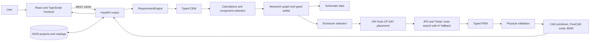

# Electrical Panel Design Automation

## A. Project Overview

**Electrical Panel Design Automation** is a prototype web application for generating a Distribution Board (DB) design package from a small set of electrical requirements. It connects requirement entry, simplified calculations, catalog-based component selection, an electrical graph and netlist, a schematic, physical placement, wire routes, physical checks, a bill of materials (BOM), and CAD-oriented output.

The project explores how a design can be carried through several engineering stages while keeping the objects between stages traceable. Its main contracts are the **Canonical Engineering Model (CEM)** for electrical intent and the **Physical Design Model (PDM)** for enclosure geometry and placement.

The current implementation is a **DB prototype** backed by sample JSON catalogs. Its outputs are useful for demonstrating software architecture and a simplified workflow. They are not certified electrical designs and must not be used as construction or installation instructions.

## B. Problem Statement and Proposed Solution

Panel design information is often spread across requirement sheets, calculations, component lists, schematics, and layout drawings. When a requirement changes, a person may need to update several files and check that the references still match.

This application demonstrates a connected workflow. It accepts DB requirements, validates them, generates the CEM, and passes selected CEM data into the physical-design stage. Generated outputs share component, net, connection, and route identifiers so the schematic, placement, BOM, and CAD representation can be compared. A requirement change can regenerate the design and return a before-and-after summary.

## C. Technology Stack

| Technology | Purpose in this project |
|---|---|
| Python 3.10+ | Backend services, API routes, models, repositories, and algorithms. The current workspace was run with Python 3.12. |
| FastAPI | REST API and interactive OpenAPI documentation. |
| Pydantic | Typed requirement, CEM, electrical graph, and PDM models. |
| NetworkX | Builds a directed graph of panel components and electrical relationships. |
| OR-Tools CP-SAT | Solves the constrained component-placement problem. |
| Shapely | Performs 2D component-footprint overlap, boundary, and clearance geometry checks. |
| JSON files | Store the demo project and the requirement, component, enclosure, and rule data. There is no SQL or NoSQL database. |
| React 18 and TypeScript | Frontend views and typed client-side state. |
| Vite | Frontend development server and production build. |
| Zustand | Shared frontend project and generated-design state. |
| Tailwind CSS | Frontend styling. |
| Three.js, React Three Fiber, and Drei | Interactive browser-side 3D panel visualization. |
| Lucide React | User-interface icons. |
| Tauri 2 and Rust | Desktop-wrapper configuration is present. The main development workflow remains the web frontend plus a separately started backend. |

The routing and placement modules use custom Python code alongside OR-Tools. The project does not use machine learning to make design decisions.

## D. Main Features and Functionalities

- **Guided DB requirements:** enter supply voltage, phases, frequency, incomer rating, feeder count, enclosure IP rating, spare-capacity percentage, and whether a neutral bar is required. Standard and heavy DB preset buttons are shown; see the preset caveat under limitations.
- **Project creation:** create a named DB project with the current requirement values. The API rejects missing names, unsupported archetypes, malformed requirement objects, and duplicate IDs.
- **Requirement validation:** check required values, declared types, enumerated options, whole-number fields, configured ranges, unknown fields, and a small number of cross-field warnings.
- **Simplified engineering calculations:** produce typed CEM calculation records for capacity, design current, busbar rating, average feeder current, conductor area, estimated voltage drop, and heat loss.
- **Catalog component selection:** select an incomer MCCB and busbar by rating and available catalog data, then add demo SPD, feeder-breaker, neutral/earth-bar, and terminal-block entries.
- **Electrical graph and netlist:** create a directed component graph and typed nets/connections. The generated connection IDs and net IDs are carried into downstream outputs.
- **Schematic:** return symbol and wire data for the browser's SVG schematic view.
- **Physical layout:** select a catalog enclosure, place items with a CP-SAT model, generate DIN rails, and route connections using a grid-based path search.
- **Physical validation:** report prototype geometry and identity checks, including boundaries, overlaps, clearances, thermal-density warnings, and references between CEM components, PDM placements, and routes.
- **2D and 3D views:** the 2D enclosure drawing scales into the available viewport. The Three.js editor supports component-tree selection, move/rotate gizmos, numeric transforms, visibility, grid snapping, undo/redo, and prototype collision/clearance warnings. Editor transforms are a local 3D draft; they do not alter the backend-validated layout or export.
- **BOM and traceability:** show selected catalog items and link BOM rows to component IDs and PDM positions.
- **CAD-oriented output:** return lightweight geometry primitives and offer a downloadable FreeCAD Python script. The API does not directly return a STEP file.
- **Change propagation:** regenerate after a named requirement changes and return the changed field, before/after values, a set of affected stages, and a summary of output differences.

## E. System Architecture

[](https://gitdiagram.com/jacobgeorgemathew/electrical_panel_design_automation?utm_source=readme&utm_medium=badge)

[](https://gitdiagram.com/jacobgeorgemathew/electrical_panel_design_automation?utm_source=readme&utm_medium=picture)


The application is a modular monolith: one FastAPI process contains the API, models, repositories, and design services. The React frontend calls the API directly using `VITE_API_BASE`.



The CEM and PDM are the data contracts between electrical and physical stages. The diagram and route calculations are regenerated by the orchestrator; generated design snapshots are returned by the API but are not saved as a design-history database.

## F. Project Folder Structure

```text
Electrical_Panel_Design_Automation/
├── README.md
├── DB_WORKFLOW.md
├── TEST_CASES_FOR_TEACHER.md
├── LAYOUT_PIPELINE_INTEGRATION_SUMMARY.md
├── backend/
│   ├── desktop_main.py
│   ├── app/
│   │   ├── main.py
│   │   ├── algorithms/
│   │   │   ├── cp_sat_placement.py
│   │   │   ├── jps_theta_star.py
│   │   │   └── layout_config.py
│   │   ├── api/                 # FastAPI route modules
│   │   ├── data/                # JSON demo projects, catalogs, and templates
│   │   ├── models/              # Pydantic requirements, CEM, graph, and PDM
│   │   ├── repositories/        # JSON-backed data access
│   │   └── services/            # Orchestration and design-stage logic
│   └── tests/
│       └── test_backend.py      # Focused backend tests
└── frontend/
    ├── .env.development         # Development API base URL
    ├── package.json
    ├── vite.config.ts
    ├── src/
    │   ├── App.tsx              # Backend startup gate
    │   ├── MainApp.tsx          # Project page entry
    │   ├── api/                 # HTTP client and backend health check
    │   ├── components/          # Requirements, schematic, layout, 3D, BOM, validation
    │   │   ├── layout/          # Responsive 2D viewer and test
    │   │   └── threeD/          # Editor, geometry checks, camera-fit tests
    │   ├── pages/ProjectPage.tsx
    │   ├── stores/projectStore.ts
    │   └── types/               # Frontend CEM and PDM interfaces
    └── src-tauri/               # Optional Tauri desktop wrapper
```

Important JSON files are `backend/app/data/panel_templates.json` (question definitions and functional modules), `components.json` (prototype component catalog), `enclosures.json` (enclosure dimensions, ratings, plate dimensions, and zones), and `sample_projects.json` (saved sample projects). `rules.json` and `RuleRepository` are also present; the current orchestrated DB flow should not be presented as a standards-compliance engine.

## G. Application Workflow

1. **Open the frontend.** `App.tsx` checks the backend health endpoint. `ProjectPage.tsx` starts generation for its default project ID when no CEM is in frontend state.
2. **Enter requirements or select a preset.** The questionnaire loads DB questions from the API. Values are held in Zustand until the user validates/generates, creates a project, or applies a change.
3. **Send JSON to FastAPI.** `src/api/client.ts` sends requests to the configured API base. The current `.env.development` value ends in `/api`, matching the route prefixes.
4. **Validate and build CEM.** The orchestrator loads a saved project, or uses an in-memory default for an unknown project ID. It validates requirements and creates a typed CEM. Invalid requirements stop generation with a structured design error.
5. **Calculate and choose components.** Calculation records feed the selector. The selector checks the component catalog and creates stable CEM component IDs such as `QF001`, `BUS001`, and `X001`.
6. **Build graph, netlist, and schematic.** Graph nodes and edges identify the electrical topology. The netlist validates component and terminal references. Schematic wires use the netlist connection IDs.
7. **Select enclosure and place components.** Enclosure selection filters the JSON catalog by estimated size, heat capacity, and requested IP rating. CP-SAT places the selected components inside the chosen enclosure dimensions.
8. **Route and validate.** The router uses placed components, netlist connections, and enclosure dimensions. The PDM stores the enclosure, components, rails, route waypoints, and validation results. Critical validation violations stop final generation.
9. **Return and display outputs.** The response contains `cem`, `pdm`, `schematic`, `cad`, `bom`, and validation results. Zustand stores those objects, and the selected frontend tab renders the corresponding view.
10. **Handle a change.** The propagation endpoint regenerates the old and new design, computes a diff, and saves the new requirement only when regeneration succeeds.

## H. Important Code Explained

### 1. `backend/app/services/orchestrator.py` — `DesignOrchestrator.generate_design`

This is the main coordinator. It gets a project and requirement overrides, validates requirements, builds CEM data, and calls each stage service. It constructs the PDM only after selecting an enclosure, placing components, and routing connections. It runs validation before returning the result package.

The key contract hand-off is visible here:

```python
cem = CanonicalEngineeringModel(
    project_id=project_id,
    panel_id=f"DB-{project_id}",
    panel_type="DB",
    state=CEMState.REQUIREMENTS_VALIDATED,
    requirements=req_set.items,
)
```

The requirement set is typed before calculations and component selection are added. The method returns dictionaries produced from typed CEM/PDM models for JSON serialization.

### 2. `backend/app/services/requirement_engine.py` — `validate_requirements`

Loads question definitions from `panel_templates.json`, checks unknown fields, applies defaults, evaluates dependencies, and records errors/warnings in a `RequirementSet`. For numeric values, it checks type before range; for selected fields it also requires whole numbers. It does not calculate a complete customer load schedule.

### 3. `backend/app/services/calculation_engine.py` — `calculate_db_parameters`

Produces a list of `CalculationResult` records. Examples of the prototype formulas are:

```python
total_capacity_kva = (math.sqrt(3) * voltage * incomer_rating) / 1000.0
design_load_current = incomer_rating * 0.75 * (1.0 + spare_capacity)
busbar_rating = incomer_rating * 1.25
```

For three-phase input, capacity uses `√3 × V × I`; otherwise it uses `V × I`. The other calculations use fixed assumptions, such as a 0.75 diversity factor, fixed equivalent cable length/resistance for estimated voltage drop, and estimated heat loss. The PDM thermal-density check separately sums selected catalog component heat-loss values, so it is not necessarily equal to the CEM's `CALC_007` estimate. These are demo estimates, not validated sizing instructions.

### 4. `backend/app/services/component_selector.py` — `select_components`

Filters catalog entries for MCCB current, pole count, and minimum breaking capacity, and picks the lowest-rating/width/ID candidate from the qualifying set. It chooses a busbar meeting the calculated minimum. The SPD and supporting catalog objects use prototype selections. Feeder breakers follow a fixed repeating pattern (16 A, 32 A, and, on three-phase configurations, selected 40 A three-pole feeders); there is no per-load feeder sizing input. Unsupported capacities or missing catalog items raise `DesignError`.

### 5. `backend/app/services/graph_engine.py` and `netlist_engine.py`

`GraphEngine` uses a directed NetworkX graph to model the panel root, incomer, busbar, SPD, feeder breakers, terminals, and neutral/earth bars. `NetlistEngine` converts that topology into typed `NetRef` and `ConnectionRef` objects and checks the references. The IDs are reused downstream; a physical component has a PDM ID such as `PDM-QF001` plus a `cem_component_id` of `QF001`.

### 6. `backend/app/algorithms/cp_sat_placement.py` — `CPSATPlacementOptimizer.solve`

Classifies parts as DIN-mounted or plate-mounted, converts millimetres to a configurable grid (5 mm by default), and asks OR-Tools CP-SAT for feasible positions. DIN parts choose exactly one rail row; interval constraints prevent same-row overlap. Plate parts are modeled as rectangles with clearance and `NoOverlap2D` constraints. The solver tries increasing row counts until it finds a feasible layout or exhausts the available space. A separate geometry check checks the solver result.

Hard constraints determine whether a placement is feasible. A weighted objective prefers shorter estimated connection distances, preferred component heights/zones, and thermal placement preferences. The objective is a layout heuristic, not proof of an optimal real-world panel design.

### 7. `backend/app/algorithms/jps_theta_star.py` — `JPSThetaStarRouter.route_layout`

Takes the placement result and CEM netlist connections, then searches a bounded occupancy grid for paths between terminal coordinates. It uses JPS/Theta* search with an A* fallback when pruning cannot find a path. Coordinates and waypoints are represented in millimetres and tied to the selected enclosure. It is a prototype path planner; it does not model all cable installation, bend-radius, segregation, or electrical constraints.

### 8. `backend/app/services/validation_engine.py` — `validate_pdm`

Uses Shapely rectangles for component footprints and checks mounting-plate bounds, overlaps, and configured clearances. It calculates a simplified enclosure thermal-density index. It also checks route IDs/endpoints/waypoints and that CEM components, PDM components, CEM connections, and PDM routes refer to one another consistently. It does not perform a standards or safety audit.

### 9. `backend/app/services/change_propagation.py` and `backend/app/api/routes_design.py`

`compute_diff` reports the changed requirement and before/after summaries such as feeder count, incomer rating, enclosure size, heat loss, and route count. The route generates the old and proposed design, computes the diff, and persists the change only after the proposed generation succeeds. The affected-stage list comes from a predefined dependency map.

### 10. `backend/app/services/cad_engine.py` and `backend/app/api/routes_cad.py`

`generate_parametric_geometry` creates simple box and tube primitives for the selected enclosure, backplate, rails, PDM components, and wire routes. `export_freecad_script` returns a Python script that uses FreeCAD's `Part` module and calls `Part.export(..., 'panel_model.step')` when run inside FreeCAD. The current browser 3D view is separately drawn from PDM data with Three.js; catalog STEP model filenames are metadata and are not loaded as detailed manufacturer geometry.

## I. Core Algorithm and Business Logic

The design pipeline is coordinated, but it contains several smaller algorithms rather than one single optimizer:

1. **Validate the input.** Load the DB question schema, merge user values with defaults, and reject unknown fields, invalid types/options, missing required values, and out-of-range values.
2. **Calculate estimates.** Calculate panel apparent capacity, a diversity-adjusted design current, minimum busbar rating, average feeder current, conductor area estimate, voltage-drop estimate, and heat-loss estimate.
3. **Select prototype parts.** Filter catalog candidates by a few rating constraints, then add demo feeder devices and bars/terminals. If required capacity is absent from the catalog, return a structured error.
4. **Create electrical topology.** Build the graph and netlist, assign connection IDs, and verify that component/terminal references exist.
5. **Choose enclosure.** Estimate minimum mounting dimensions from aggregate component width, heat, and requested IP level. Select the smallest catalog enclosure that passes those filters.
6. **Place parts.** Model part positions on a 5 mm grid. Enforce enclosure bounds, non-overlap, rail-row selection for DIN parts, plate clearances, and separation from rail bands. Minimize a weighted score that includes estimated connection distance, vertical preference, and zone preference.
7. **Route wires.** Convert obstacles and endpoints to an occupancy grid. Search for a path for each netlist connection; fall back to A* if the faster JPS/Theta* search fails.
8. **Validate and emit.** Check the PDM geometry and cross-model references. On success, return the CEM, schematic data, PDM, validation report, BOM rows, and CAD representations.

Simplified pseudocode:

```text
requirements = validate(project.requirements + overrides)
cem = calculate_and_select(requirements)
cem.graph, cem.nets = build_and_validate_netlist(cem.components)
schematic = draw_schematic_data(cem)
enclosure = choose_catalog_enclosure(cem, requirements.ip_rating)
placement = solve_cp_sat(cem.components, enclosure, cem.connections)
pdm.routes = route_connections(placement, cem.nets, enclosure)
violations = validate_pdm(pdm, cem)
if any critical violation: return structured error
return {cem, schematic, pdm, bom, cad, violations}
```

This approach is suitable for a prototype because it separates electrical intent, physical geometry, and presentation data. The simplified assumptions and catalog are too limited for real engineering decisions.

## J. Frontend and Backend Communication

The frontend uses JSON over HTTP. In development, `frontend/.env.development` sets `VITE_API_BASE` to `http://127.0.0.1:8731/api`. The API client appends route paths such as `/projects/{id}/design/generate`. The backend health endpoint is at the server root (`/health`), so `waitForBackend` removes the trailing `/api` before checking it.

| Method and endpoint | Request | Response / purpose |
|---|---|---|
| `GET /health` | None | Service status and advertised model/archetype names. |
| `GET /api/projects` | None | All projects loaded from the JSON repository. |
| `GET /api/projects/{project_id}` | Path ID | Saved project, or a generated default project record if that ID is absent. |
| `POST /api/projects` | `{ "name": "...", "archetype": "DB", "requirements": { ... } }` | Creates and saves a DB project. |
| `GET /api/projects/{project_id}/requirements/questions` | Optional `archetype` query, default `DB` | Questionnaire definitions. |
| `POST /api/projects/{project_id}/requirements/validate` | JSON object of requirement values | A `RequirementSet` containing items, `is_valid`, errors, and warnings. |
| `POST /api/projects/{project_id}/design/generate` | Optional JSON object of requirement overrides | Full generated package: `cem`, `pdm`, `schematic`, `cad`, `bom`, and validation errors. |
| `POST /api/projects/{project_id}/design/propagate-change` | `{ "modified_field": "...", "new_value": ... }` | Regenerated design plus `diff_report`. |
| `POST /api/projects/{project_id}/design/validate-placement` | Edited PDM JSON | Validates submitted geometry using the prototype PDM validator and returns the PDM with structured violations. It does not persist the PDM or regenerate downstream outputs. |
| `GET /api/projects/{project_id}/layout` | Path ID | Generated PDM. |
| `GET /api/projects/{project_id}/schematic` | Path ID | Generated schematic symbols and wires. |
| `GET /api/projects/{project_id}/validation` | Path ID | Validation violations and thermal summary. |
| `GET /api/projects/{project_id}/cad` | Path ID | Lightweight CAD primitive geometry. |
| `GET /api/projects/{project_id}/cad/freecad-script` | Path ID | `{ "script": "..." }` containing the FreeCAD export script. |

Expected design failures use HTTP 422 with an `error` object containing a code, message, details, and errors. Project creation uses 422 for invalid project data and 409 for an existing project ID. The requirement-validation endpoint returns a result object with validation errors; it does not itself generate the design.

## K. Database and Data Management

There is no database server, schema migration, or ORM. Project data is stored in `backend/app/data/sample_projects.json`; the project repository reloads that file for reads and writes the complete project list on save. Components, enclosures, panel templates, and rules are separate JSON catalogs loaded by repository/service classes.

Generated CEM/PDM packages are assembled for each API generation request. The current code does not maintain a versioned design history or save every generated geometry package. `frontend/src/stores/projectStore.ts` holds the active design in browser memory.

`desktop_main.py` can set a `PANEL_DATA_DIR` environment variable for the Tauri sidecar, but the current `ProjectRepository` still defaults directly to `app/data/sample_projects.json`; do not assume the data directory is honored by project persistence.

## L. Installation and Execution

### Prerequisites

- Git
- Python 3.10 or newer
- Node.js 18 or newer and npm
- FreeCAD only if you want to execute the downloaded script to create a STEP file

### Obtain the project

```bash
git clone https://github.com/nithin1018/Electrical_Panel_Design_Automation.git
cd Electrical_Panel_Design_Automation
```

If you already have the project folder, open two terminals in it instead.

### Install and start the backend

From the project root:

```powershell
cd backend
python -m venv .venv
.\.venv\Scripts\Activate.ps1
python -m pip install --upgrade pip
python -m pip install fastapi "uvicorn[standard]" pydantic networkx shapely ortools pytest
python -m uvicorn app.main:app --reload --host 127.0.0.1 --port 8731
```

For macOS/Linux, activate with `source .venv/bin/activate` instead. There is currently no backend `requirements.txt` or `pyproject.toml`, so dependencies are installed explicitly. Keep this terminal running. Check `http://127.0.0.1:8731/health`; interactive API docs are at `http://127.0.0.1:8731/docs`.

### Install and start the frontend

In a second terminal from the project root:

```powershell
cd frontend
npm ci
npm run dev -- --host 127.0.0.1
```

Open `http://127.0.0.1:3000/`. The development API URL is set in `frontend/.env.development`. If you change the backend address, update `VITE_API_BASE` to the backend address ending in `/api`, then restart Vite so it reloads the environment value.

`vite.config.ts` also contains a proxy rule for port 8000, but the current API client uses `VITE_API_BASE` directly. The `.env.development` value is the active development configuration.

### Build and test commands

```bash
cd frontend
npm run build
npm test
```

```bash
cd backend
python -m pytest
```

The backend tests are in `backend/tests/test_backend.py`. Frontend camera-framing and viewer-container tests are in `frontend/src/components/threeD/`; run them with `npm test` from `frontend`.

## M. Sample Demonstration

Use the preloaded sample DB or create a new project named **Presentation DB**. The default values are:

| Requirement | Value |
|---|---:|
| Supply voltage | 415 V |
| Phases | 3 |
| Frequency | 50 Hz |
| Incomer | 250 A |
| Feeders | 12 |
| IP rating | IP54 |
| Spare capacity | 20% |
| Neutral bar | Yes |

### Suggested live steps

1. Show the requirements and point out which values come from the form and which have defaults.
2. Click **Validate & Generate** and show the calculation cards.
3. Open **Schematic**, **2D Layout**, and **3D Panel**. Explain that the React Flow schematic expresses electrical connectivity, while the layout views show physical placement.
4. Open **Validation** and explain the warning. For the current default fixture, a direct generation produced one thermal-density warning (`0.49 W/L` against the prototype threshold of `0.45 W/L`). It is a simplified warning, not a thermal compliance result.
5. Open **BOM & Traceability** and show the shared component IDs and physical positions. Use **Export FreeCAD Script** to download the Python script; a STEP export is produced only when that script is run in FreeCAD.
6. Change a requirement using **Review & Apply Change** and show the before/after report. Use a feasible value so the regenerated design succeeds.

### Verified default-fixture output

A direct call to `DesignOrchestrator.generate_design` with the default DB requirements (using a new in-memory project ID) returned:

- CEM state: `FINAL_VALIDATED`
- Selected enclosure: `ENC_800_1000_300`, dimensions `800 × 1000 × 300 mm`
- 29 CEM components and 29 BOM rows
- 20 nets and 44 connections
- 30 schematic symbols and 44 schematic wires
- 44 PDM routes
- 78 lightweight CAD primitives
- One non-critical thermal warning at `0.49 W/L`

These are outputs of the current sample catalog and fixed assumptions. They demonstrate data flow and traceability, not suitability of this panel for a real installation.

## N. Limitations and Future Improvements

### Current limitations

- Only the DB generation path is supported by the orchestrator. Other archetype names may appear in health metadata but are not implemented design flows.
- The questionnaire and catalog are small demo fixtures. Feeder breaker selection follows a fixed pattern and does not use individual load schedules.
- Calculations rely on fixed assumptions for diversity, conductor area, voltage drop, and heat loss. The code explicitly describes voltage drop as an estimate.
- The CEM's calculated heat-loss estimate and the PDM's sum of catalog component losses are separate values and can differ.
- Enclosure dimensions, component dimensions, and terminal coordinates are prototype catalog values.
- Placement models simplified rectangular footprints on a grid. Routing starts and ends at catalog terminal coordinates, searches the actual placed footprints, applies a prototype 2D wire-clearance buffer, and reports a structured failure for an unroutable connection. It does not model 3D obstacles, wire-class segregation, bend-radius rules, duct capacity, or manufacturing/install constraints; the depth between terminal levels is interpolated.
- React Flow schematic node, wire, and junction edits are in-memory drafts. The CEM electrical graph remains the source of connectivity; draft graph edits do not update CEM or generated downstream outputs.
- The SVG 2D layout supports footprint dragging, rotation, numeric coordinates, snapping, alignment, selection, and clearance highlighting. **Apply & Validate** copies those transforms into the frontend's in-memory PDM and calls the PDM validator. The endpoint does not persist the edited PDM or regenerate routes, BOM, or CAD; moved components can therefore trigger stale-route violations. Generate Design restores the generated placement.
- 3D editor transforms, visibility, and undo/redo are local viewing drafts. They do not update PDM, routes, validation, BOM, 2D layout, or FreeCAD export. The editor's rotated bounding-box checks are advisory and do not replace backend validation.
- Validation performs prototype geometry, reference, and density checks. It does not verify fault levels, protection coordination, conductor ampacity, standards clauses, or safe installation.
- Browser geometry uses generic boxes/tubes. Manufacturer CAD models are not loaded. FreeCAD script generation is implemented, but executing FreeCAD or creating/inspecting a STEP file is outside the API request.
- Projects use JSON files and there is no multi-user concurrency, transaction, audit history, or database migration layer.
- The current frontend stores only the active generated result in browser memory; no project-selection/history workflow is implemented.

### Possible future work

Potential enhancements include load-schedule-based sizing, richer catalogs with verified manufacturer data, more complete engineering checks, a design-history store, a more robust desktop data directory, 3D routing/segregation rules, and additional panel archetypes. These are proposals; they are not current features.

## O. Frequently Asked Questions for the Presentation

1. **Why did you choose this project?**  
   It lets us demonstrate a multi-stage engineering workflow and how structured data can connect calculations, component selection, diagrams, physical layouts, validation, and output generation.

2. **What problem does the application solve?**  
   It reduces the disconnect between separate prototype design artifacts by creating them from one generated design package with shared object identifiers.

3. **What is the CEM?**  
   The Canonical Engineering Model is a typed Python model for requirements, functional modules, calculations, selected components, an electrical graph, nets, and connections.

4. **What is the PDM?**  
   The Physical Design Model is a typed model for the selected enclosure, zones, physical component positions, rails, wire routes, clearances, and validation results.

5. **How do the CEM and PDM connect?**  
   A placed PDM component stores `cem_component_id`. Routes keep CEM net and connection references, and validation checks those references against the CEM.

6. **What technologies are most important?**  
   FastAPI and Pydantic define the API and model contracts; NetworkX builds electrical relationships; OR-Tools solves placement; Shapely checks 2D footprints; React and TypeScript display the generated results.

7. **What is the main algorithm?**  
   There is not one algorithm. The orchestrator runs requirement validation, calculations and catalog selection, graph/netlist creation, enclosure selection, CP-SAT placement, grid-based routing, validation, and output generation in sequence.

8. **Why use CP-SAT for placement?**  
   Placement includes discrete choices such as which rail row a DIN component uses, plus geometric constraints such as boundaries and non-overlap. CP-SAT can model these choices and constraints together.

9. **How are components selected?**  
   The selector filters JSON catalog entries against a few requested ratings. Feeder breakers use a fixed demo pattern; they are not sized from individual loads.

10. **How does the frontend communicate with the backend?**  
    It sends JSON HTTP requests to FastAPI endpoints. In development, `VITE_API_BASE` points at the local backend and includes the `/api` prefix.

11. **Where is project data stored?**  
    Projects are stored in `backend/app/data/sample_projects.json`; catalogs and question templates are other JSON files. There is no database server.

12. **What happens when requirements are invalid?**  
    The validation endpoint reports errors and warnings. Design generation stops for invalid input and the API returns a structured error, normally HTTP 422 for a `DesignError`.

13. **What does the physical validation check?**  
    It checks simple component bounds, overlaps, clearances, a thermal-density indicator, route bounds, and consistency of references between the CEM and PDM. It does not certify an electrical design.

14. **Does the app create a STEP file directly?**  
    No. The API returns lightweight geometry and a downloadable FreeCAD Python script. Running that script inside FreeCAD calls its export function to create `panel_model.step`.

15. **Are the calculations standards-compliant?**  
    No. They use simplified fixed assumptions and sample catalog data. The project is a prototype and makes no standards-compliance or production-readiness claim.

16. **What does change propagation do?**  
    It regenerates a before design and a proposed after design, computes a report, and saves the new requirement only if regeneration succeeds.

17. **How much testing is present?**  
    `backend/tests/test_backend.py` covers requirement validation, selection/enclosure failures, model identity consistency, structured errors, obstacle and impossible routes, route-terminal and collision validation, and change propagation. Frontend tests cover 2D fit, 3D camera resize, editor geometry warnings, and undo/redo. Run `python -m pytest` from `backend`, and `npm test` plus `npm run build` from `frontend`. `TEST_CASES_FOR_TEACHER.md` contains a presentation-ready manual test sheet.

18. **What is the most important limitation to mention?**  
    The outputs are generated from simplified calculations and demo data. They are useful for demonstrating software flow and traceability, not for approving a real panel design.

19. **What would you improve next?**  
    First add validated load schedules and catalog data, then expand engineering checks and integration tests before adding more panel types or deployment infrastructure.

## P. Presentation Speaking Guide (Approximately 5–7 Minutes)

### Speaker 1 — Introduction and problem (about 1 minute)

“Our project is Electrical Panel Design Automation. Panel requirements, calculations, component lists, schematics, and physical layouts are often managed as separate artifacts. A change can make those artifacts disagree. We built a prototype that carries a DB design through these stages from one structured model. The goal is to demonstrate connected engineering data, not to replace an engineer or certify a design.”

### Speaker 2 — Solution, features, and stack (about 1–1.5 minutes)

“The user enters DB requirements in a React and TypeScript interface. The frontend sends JSON requests to a FastAPI backend. Pydantic models describe the CEM and PDM, and sample projects and catalogs are JSON files. The backend validates requirements, calculates estimates, selects prototype catalog items, and creates an electrical graph and netlist. The frontend then displays a schematic, physical layout, 3D view, validation summary, and BOM.”

### Speaker 3 — Architecture and key algorithm (about 1.5–2 minutes)

“The orchestrator in `backend/app/services/orchestrator.py` coordinates the stages. The CEM captures electrical intent and IDs. The placement module uses OR-Tools CP-SAT: DIN devices select rail rows, plate components receive coordinates, and the constraints prevent overlaps and keep parts within bounds. The routing module searches for paths between netlist terminals. The PDM then records the enclosure, positions, rails, routes, and validation results. Shared IDs let us compare objects across these outputs.”

### Speaker 1 or 2 — Live demonstration (about 1.5 minutes)

“We’ll use the default 415 V, three-phase, 250 A, 12-feeder DB. First we validate and generate. Then we’ll switch through the schematic, 2D layout, 3D view, validation, and BOM. The default fixture currently reports a thermal-density warning of 0.49 W/L, above the prototype threshold of 0.45 W/L. We’ll explain that this is a simplified indicator, not a standards check. Finally, we’ll show how a requirement change produces a before-and-after report and how the FreeCAD script can be downloaded.”

### Speaker 3 — Conclusion and future scope (about 1 minute)

“The main result is a connected prototype pipeline with traceable identifiers and explicit CEM/PDM data contracts. It uses simplified formulas and sample catalogs, so it is not production engineering software. Future work would improve the input load model and verified catalog, add more complete engineering checks and integration coverage, and only then expand the supported design scope.”
