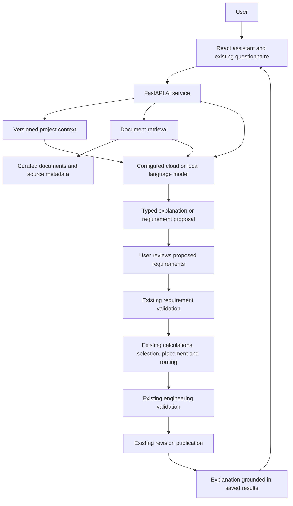

# Study and Ranking of AI Integration Methods

**Project:** Electrical Panel Design Automation  
**Study date:** 3 November 2026  
**Scope:** Project-specific architectural study of eight AI integration approaches  
**Evidence:** Repository source review and primary technical documentation  
**Status:** Recommendation report; no AI integration, model training, or performance benchmark was performed for this study.

## 1. Executive recommendation

The most suitable overall direction is **Hybrid AI: a backend assistant combining a language model, retrieval of relevant documentation, and the existing engineering engines**. The language model interprets requests and explains results; the application calculates, selects, places, routes, validates, and publishes designs through its established services.

For implementation, begin with **a backend AI service using one cloud API**. Add RAG after preparing a small, reliable document collection, then connect narrowly defined engineering operations to complete the hybrid workflow. A local model is an alternative deployment choice when offline operation or data confidentiality becomes a firm requirement.

The resulting overall ranking is:

| Rank | Method | Weighted score / 100 | Recommendation for this project |
|---|---|---:|---|
| 1 | Hybrid AI | 85 | Best overall architecture when built incrementally around the existing engines. |
| 2 | Retrieval-Augmented Generation (RAG) | 82 | Best knowledge-grounding addition for project and manufacturer documentation. |
| 3 | Backend AI Service | 81 | Best application integration foundation; implement this first. |
| 4 | Cloud AI API | 77 | Fastest model access for an initial prototype. |
| 5 | Local AI Model | 65 | Prefer when offline operation or local data processing outweighs deployment effort. |
| 6 | Agentic AI | 59 | Consider later for bounded investigation and design-option exploration. |
| 7 | Fine-tuning | 42 | Defer until a specific recurring task and a reviewed training dataset justify it. |
| 8 | Embedded Model | 40 | Defer unless distributing a self-contained offline application becomes a product requirement. |

**Interpretation:** These are reasoned decision scores under stated assumptions, not measured accuracy percentages. The top three are close enough that they should be treated as complementary priorities. Their combination is more useful than selecting only one.

## 2. What the project currently implements

### 2.1 Observed architecture

The repository implements a Distribution Board (DB) design prototype. Its engineering workflow already contains substantial automation without machine learning.

| Existing capability | Repository evidence | Implication for AI integration |
|---|---|---|
| React/TypeScript interface and optional Tauri desktop wrapper | [Frontend dependencies](../frontend/package.json), [desktop configuration](../frontend/src-tauri/tauri.conf.json) | An assistant can be added to the existing interface; a new application platform is unnecessary. |
| Modular FastAPI backend | [Application setup](../backend/app/main.py), [API client](../frontend/src/api/client.ts) | AI requests can pass through the existing backend. |
| Versioned questionnaire and requirement validation | [Requirement engine](../backend/app/services/requirement_engine.py), [requirement routes](../backend/app/api/routes_requirements.py) | Natural-language extraction should produce a proposal for these validators. |
| Explicit calculations and catalog-based component selection | [Calculation engine](../backend/app/services/calculation_engine.py), [component selector](../backend/app/services/component_selector.py) | Numerical results and catalog eligibility can remain controlled by application code. |
| Typed Canonical Engineering Model (CEM) and Physical Design Model (PDM) | [CEM](../backend/app/models/cem.py), [PDM](../backend/app/models/pdm.py) | The assistant can consume structured design evidence with stable identifiers. |
| CP-SAT placement and duct-constrained routing | [Placement optimizer](../backend/app/algorithms/cp_sat_placement.py), [duct router](../backend/app/algorithms/duct_routing.py), [orchestrator](../backend/app/services/orchestrator.py) | AI need not invent coordinates or conductor routes. The current orchestrator uses `DuctRouter`; its routing records identify duct-Manhattan-A*. |
| Physical and identity checks | [Validation engine](../backend/app/services/validation_engine.py) | Suggestions can be checked against implemented constraints. |
| PostgreSQL persistence and immutable engineering revisions | [Project service](../backend/app/services/project_service.py), [revision persistence](../backend/app/persistence/revisions.py) | AI proposals should preserve the existing version checks and revision publication workflow. |

The reviewed design path uses explicit formulas, catalog filters, optimization, and search. The [backend dependencies](../backend/requirements.txt) contain no dedicated LLM inference or fine-tuning framework. This study found no established, reviewed prompt–answer training corpus in the inspected project material. Existing catalogs, fixtures, and saved design snapshots are useful context, but are not automatically suitable supervised training examples.

Source code was used to resolve differences between summary documentation and the current implementation, especially for routing. The [project methodology report](PROJECT_REPORT_METHODOLOGY_ARCHITECTURE_MODULES.md) provides additional context.

### 2.2 AI features that would add practical value

| Proposed feature | Example | Appropriate AI role |
|---|---|---|
| Requirement interpretation | Convert a written DB specification into questionnaire fields. | Extract explicit values, identify omissions, and ask targeted questions. |
| Design explanation | Explain why a particular busbar or enclosure was selected. | Describe recorded calculations and selection evidence. |
| Document assistance | Answer a question about a catalog entry or project procedure. | Retrieve relevant material and provide verifiable references. |
| Validation assistance | Explain a placement or routing failure. | Translate structured error details into possible next steps. |
| Change explanation | Explain the effect of increasing feeder count. | Summarize actual before/after outputs from the engineering pipeline. |
| Report drafting | Produce a narrative design summary. | Render saved requirements, BOM, calculations, and limitations into readable prose. |

The initial scope should be **requirement interpretation and design/validation explanation**. Document assistance follows once the retrieval corpus is ready.

### 2.3 Engineering scope and limitations

The existing project remains a prototype. Its calculations include fixed assumptions, and component selection includes a predefined feeder mix. Its thermal and geometry checks do not establish complete protection coordination, conductor ampacity, or electrical standards compliance. AI assistance cannot expand those capabilities merely by describing them confidently.

Every approach in this study assumes that generated proposals pass through the existing engineering checks. A schema-valid response, a retrieved standards passage, or a successful solver run is evidence only within its actual scope. Final engineering suitability still requires the missing engineering data and appropriate review.

## 3. How the eight methods relate

These approaches describe different architectural dimensions. They are not eight mutually exclusive model types.

| Method | Architectural dimension | Working definition in this report |
|---|---|---|
| Cloud AI API | Model hosting | An externally hosted model accessed over an API. |
| Local AI Model | Model hosting | A separately managed model runtime on the user's workstation or an organization-controlled machine. |
| Embedded Model | Packaging and execution | A model and inference runtime integrated into the distributed application or device. |
| Backend AI Service | Application structure | An application-owned API/service layer that manages model calls, context, validation, and operational controls. |
| Agentic AI | Control flow | A model dynamically chooses tools and subsequent steps toward a goal. |
| RAG | Knowledge access | Relevant external information is retrieved and supplied to the model at inference time. |
| Fine-tuning | Model adaptation | A pretrained model's parameters or adapters are trained on additional examples. |
| Hybrid AI | Combined architecture | Language-model assistance plus retrieval and explicit engineering engines; cloud/local routing is an optional further extension. |

An **embedded model** is not an **embedding model**. Embedding models convert content into vectors for retrieval; they can run locally or remotely and may support RAG. “Embedded” here concerns packaging inference inside the application.

Likewise, a fixed pipeline is not automatically an agent. Anthropic distinguishes predefined workflows from systems in which a model directs its own tool use and process. This report follows that distinction. [Source: Building effective agents](https://www.anthropic.com/research/building-effective-agents).

A realistic final system can therefore be:

> Backend AI Service + Cloud or Local Model + RAG + Existing Engineering Engines = Hybrid AI.

## 4. Evaluation method and assumptions

### 4.1 Baseline assumptions

The ranking assumes an incremental extension to the present DB prototype, a small development team, modest initial usage, and internet access for the first implementation. It assumes that sending selected project context to a cloud provider is permitted for that deployment. No target inference hardware, production usage forecast, firm API budget, or offline-only requirement was supplied.

The target is useful assistance within the current feature set. No method receives credit for autonomously producing certified engineering designs. Quality scores concern task correctness and grounding, rather than fluent wording alone.

### 4.2 Reference configurations being compared

Because the categories overlap, each row represents a concrete implementation choice. Scores cover the whole reference configuration rather than an isolated model component.

| Method | Reference configuration |
|---|---|
| Cloud AI API | One capable hosted model, a minimal FastAPI wrapper, basic prompt and selected project context, no document retrieval. |
| Local AI Model | A modest workstation-sized instruction model in a separate runtime, selected project context, no document retrieval. Hardware suitability remains unverified. |
| Embedded Model | A compact model packaged with the application and supported across intended desktop environments. |
| Backend AI Service | An in-process FastAPI AI module using the same hosted model as the cloud baseline, with typed responses, controlled context loading, bounded retries, logging, and version-aware proposals. |
| Agentic AI | A hosted model choosing a bounded sequence of read/proposal tools, with execution limits and the existing validation path. |
| RAG | The hosted model behind the backend, plus retrieval over a curated document collection, source metadata, and citations. |
| Fine-tuning | A hosted, task-adapted model for requirement extraction or reporting, including the work of creating reviewed examples, evaluating, and maintaining the adaptation. |
| Hybrid AI | The backend and RAG configuration plus predefined access to engineering evidence and validated draft operations. A second model provider and autonomous planning are not required. |

Cloud and backend quality scores are equal because a service layer does not itself make the underlying model more capable. Its higher suitability reflects integration and operational control. Hybrid privacy remains low-to-moderate in this baseline because its generation model is still hosted remotely.

### 4.3 Criteria and weights

All scored columns use **1 = least favorable, 5 = most favorable**. For implementation ease, a higher score means less work. Cost means affordability at modest initial usage, including additional infrastructure and preparation work.

| Criterion | Weight | Meaning for this project |
|---|---:|---|
| Suitability (S) | 25% | Fit with the existing architecture, useful features, and present readiness. |
| Implementation ease (I) | 15% | Effort to integrate, verify, and deploy the reference configuration. |
| Effectiveness (E) | 15% | Expected usefulness across interpretation, explanation, document assistance, and change support. |
| Answer quality (Q) | 15% | Expected correctness, relevance, handling of ambiguity, and grounding. |
| Traceability (T) | 10% | Ability to link assistant claims to documents, calculations, objects, and revisions. |
| Cost affordability (C) | 10% | Initial and operating cost suitability at modest usage. |
| Privacy/offline capability (P) | 5% | Ability to retain processing locally and operate without an external service. |
| Maintainability (M) | 5% | Ongoing model, document, infrastructure, and integration upkeep. |
| **Total** | **100%** | |

Suitability measures fit; effectiveness measures useful task coverage; quality measures whether answers within that coverage are dependable. They still partially correlate, so the weighted score is a decision aid rather than an objective measurement.

The calculation is:

```text
Score / 100 = (25S + 15I + 15E + 15Q + 10T + 10C + 5P + 5M) / 5
```

## 5. Study of each method

### 5.1 Cloud AI API

**How it works:** FastAPI sends prompts and limited context to a provider-hosted model, then validates the response before returning an assistant result to React.

**Best project uses:** Natural-language requirement extraction, readable explanations of CEM calculation records, validation-message explanation, and report drafting.

**Advantages:** No local model installation or training pipeline is needed. It offers a quick route to testing a capable language model, with relatively little inference infrastructure to maintain. Some providers support schema-constrained output; Claude's structured-output documentation describes JSON-schema-based responses and strict tool inputs. [Source: Claude structured outputs](https://platform.claude.com/docs/en/build-with-claude/structured-outputs).

**Limitations:** Network availability, provider quotas, latency, changing API behavior, and usage charges become dependencies. The model does not automatically know the current catalog, engineering revision, or project implementation. It can fabricate values or explanations when context is insufficient. Structured output controls format; application validation must establish meaning and eligibility.

**Implementation assessment:** Lowest model-access effort. Keep the provider credential in backend configuration. Google explicitly recommends a backend proxy rather than exposing a production API key in client-side applications. A shared credential packaged in a distributed Tauri application is also extractable. [Source: Gemini API key guidance](https://aistudio.google.com/docs/api-key).

**Verdict:** Best starting model-access option when cloud use is acceptable. The recommendation concerns deployment convenience, not a claim that cloud hosting inherently makes a model more accurate.

### 5.2 Local AI Model

**How it works:** A model runs in a separate process on the workstation or controlled infrastructure. FastAPI communicates with it through a local or private endpoint. Ollama supports JSON-schema output and Pydantic validation, making it compatible with typed extraction proposals. [Source: Ollama structured outputs](https://docs.ollama.com/capabilities/structured-outputs).

**Best project uses:** Offline requirement interpretation, local design summaries, and document assistance when combined with a local retrieval pipeline.

**Advantages:** Can keep inference data on controlled infrastructure and avoid per-request external model charges. Model versions can be retained for repeatable deployments. A private server can share inference across several clients.

**Limitations:** Installation, model downloads, memory capacity, inference speed, concurrency, and upgrades become project responsibilities. A compact local model may handle extraction well but perform less reliably on complex explanations; this must be evaluated rather than assumed. Local inference is not free: hardware, energy, and support remain costs. Offline operation also requires local documents and embeddings, with remote calls disabled.

**Implementation assessment:** Moderate for one workstation; higher for supporting many users and devices. Measure warm/cold latency, peak memory, and extraction quality on the intended hardware. Neither GPU availability nor adequate memory has been established in this study.

**Verdict:** Strong alternative when privacy or offline use is mandatory. It can replace the cloud model inside the same backend/RAG architecture.

### 5.3 Embedded Model

**How it works:** Ship model weights and an inference runtime with the application, or provide an application-managed download. The application owns model loading, compatibility, updates, and resource management. This can include desktop execution; it does not imply a microcontroller. Google's LiteRT-LM documents cross-platform on-device LLM execution, including desktop and web targets. [Source: LiteRT-LM overview](https://developers.google.com/edge/litert-lm/overview).

**Best project uses:** A future self-contained offline desktop assistant, compact intent classification, or narrow field extraction.

**Advantages:** Can provide offline execution without asking users to manage a separate inference server. Packaging gives the application direct control over the runtime and model version.

**Limitations:** Installer/download size, RAM use, processor differences, native dependencies, model redistribution terms, and cross-platform testing increase delivery work. The 3D viewer and engineering solver also need resources. A small packaged model may offer limited general assistance, while a larger model increases deployment burden. Packaging alone does not improve prediction quality.

**Implementation assessment:** High for a supported desktop product. The existing Tauri configuration makes the direction plausible, but does not establish that model integration, acceleration, or distribution is already implemented.

**Verdict:** Weak fit for the current incremental objective. Reconsider if self-contained offline distribution becomes an explicit requirement. A narrow classifier could be easier than the broad embedded assistant scored here.

### 5.4 Backend AI Service

**How it works:** Add an application-owned AI service behind FastAPI. It handles prompts, project snapshots, model adapters, typed responses, timeouts, budgets, and AI interaction metadata. It can call a cloud or local model.

**Best project uses:** All initial assistant features, particularly requirement proposals and explanations tied to a saved project revision.

**Advantages:** Fits the modular backend and separates model-specific code from engineering services. Context can be limited to relevant fields, credentials can stay server-side, and consistent failure handling can keep the design application usable during an AI outage. A version-aware proposal can be rejected if the project changes before it is applied.

**Limitations:** A backend service supplies architecture, not model intelligence or authoritative domain knowledge. It still needs a model. A separate microservice would introduce another deployment, network boundary, and monitoring burden; the current project does not yet demonstrate a need for that split.

**Implementation assessment:** Low-to-moderate when added as an in-process module. If a local model is later loaded inside each API worker, account for duplicated memory; FastAPI's deployment documentation explains that worker processes normally do not share model memory. [Source: FastAPI deployment concepts](https://fastapi.tiangolo.com/deployment/concepts/).

**Verdict:** Implement first as the common foundation, even though the richer hybrid configuration receives the highest overall score.

### 5.5 Agentic AI

**How it works:** The model chooses which allowed tools to call, inspects their results, and decides what to do next. A bounded agent might inspect an infeasible design, retrieve related evidence, propose alternative requirements, and request a draft evaluation.

**Best project uses:** Later-stage investigation of failures and comparison of several design alternatives where the next useful step is not fixed in advance.

**Advantages:** Can coordinate varied evidence and adapt its investigation to the encountered problem. It may reduce manual navigation across project data and diagnostics.

**Limitations:** Incorrect tool selection, repeated attempts, stale context, partial failures, and extra model calls increase verification effort, cost, and latency. A multi-step trace can be auditable while still containing incorrect reasoning. Anthropic advises starting with simple solutions and notes the latency/cost tradeoffs of agentic systems. [Source: Building effective agents](https://www.anthropic.com/research/building-effective-agents).

**Implementation assessment:** High. Expose a small tool set, validate arguments, bind operations to a project version, impose call/time/cost limits, and stop on unsupported requests. Start with read-only tools. Draft generation needs an explicit nonpublishing path because the current project generation service persists successful revisions.

**Verdict:** Useful later if a fixed retrieval-and-explanation workflow proves insufficient. The existing `DesignOrchestrator` is a predefined engineering workflow, not an LLM agent.

### 5.6 Retrieval-Augmented Generation (RAG)

**How it works:** Retrieve relevant passages or records, supply them with the question to a language model, and return an answer linked to the supporting evidence. The original RAG paper combines a language model with retrieved external memory. Its reported research results do not establish performance for this electrical project. [Source: Lewis et al., RAG paper](https://arxiv.org/abs/2005.11401).

**Best project uses:** Questions about application behavior, manufacturer instructions, catalog terminology, validation policies, and documented limitations.

**Advantages:** Documentation can be updated without retraining the generation model. Source identifiers and versions can make answers inspectable. A small corpus can start with keyword retrieval; embeddings, combined keyword/vector search, and reranking can be added when retrieval evaluation justifies them.

**Limitations:** Retrieval can miss the relevant material or return an obsolete, conflicting, or incorrectly parsed passage. Accurate numerical filtering should use structured catalog queries rather than semantic similarity alone. RAG does not guarantee that the answer follows its evidence. Microsoft's guidance identifies query understanding, relevance under token limits, response time, and access control as practical challenges. [Source: Azure AI Search RAG overview](https://learn.microsoft.com/en-us/azure/search/retrieval-augmented-generation-overview).

**Implementation assessment:** Moderate, with document preparation often more work than the initial API call. PostgreSQL is already available; pgvector is an optional extension for vector search, not an existing project dependency. Its documentation supports exact and approximate vector search. [Source: pgvector](https://github.com/pgvector/pgvector).

**Verdict:** Best knowledge-grounding addition. It needs a model and backend integration, and it complements structured engineering-data access.

### 5.7 Fine-tuning

**How it works:** Train a pretrained model on additional examples to improve a defined behavior. For this project, a candidate task is mapping varied requirement descriptions into the supported questionnaire schema. Supervised fine-tuning tools support example-based training; LoRA reduces trainable parameters by learning adapters while retaining frozen base weights. [Sources: TRL SFT Trainer](https://huggingface.co/docs/trl/sft_trainer), [PEFT LoRA](https://huggingface.co/docs/peft/main/en/conceptual_guides/lora).

**Best project uses:** Repeated extraction patterns, consistent report style, or a narrow domain task that remains unreliable after prompting and retrieval improvements.

**Advantages:** Can improve a stable task and potentially allow a smaller model to meet its target. It can be combined with retrieval and hosted either locally or remotely.

**Limitations:** Requires reviewed examples, a separate evaluation set, training/deployment management, and regression checks. Learning from flawed prototype outputs can reproduce their assumptions. Training on changing catalog facts creates an update burden; retrieval and database queries are better first choices for current part availability and ratings. Fine-tuning does not guarantee factual accuracy, constraint satisfaction, or compliance.

**Implementation assessment:** High at present because no reviewed task dataset was identified. Separate evaluation examples by source document or project family to reduce leakage. There is no universal example count that establishes readiness; use learning curves and held-out performance.

**Verdict:** Defer. First collect reviewed corrections and establish a prompt/RAG baseline. Fine-tuning means adapting an existing model, not training a foundation model from scratch.

### 5.8 Hybrid AI

**How it works:** Combine language-model interpretation, retrieved documentation, structured project evidence, and existing engineering services. The application defines the sequence and acceptance conditions. Model-driven autonomous planning is optional.

**Best project uses:** An assistant that accepts a written requirement, proposes fields, explains missing information, obtains relevant evidence, and describes the actual generated design or rejection reason.

**Advantages:** Assigns tasks to suitable components: language interpretation to the model, documentation lookup to retrieval, calculations to `CalculationEngine`, catalog eligibility to `ComponentSelector`, placement to CP-SAT, routing to the router, and acceptance to validation/persistence services. Stable CEM/PDM identifiers support traceability between the explanation and design evidence.

**Limitations:** More integration points require clear contracts and version handling. Retrieval failure, model failure, and engineering infeasibility need distinct outcomes. Explanations can still be wrong, and existing engine limitations remain. Adding automatic cloud/local switching later would require additional quality and data-handling checks.

**Implementation assessment:** Moderate for a minimal version because the engineering engines already exist; high for multi-provider routing, autonomous exploration, or complete offline desktop packaging. The score covers the minimal predefined hybrid workflow.

**Verdict:** Best overall direction. Its rank is a project-specific architectural inference from the inspected code and the preceding method analysis, not a published benchmark result.

## 6. Detailed scores and rankings

### 6.1 Complete weighted matrix

| Rank | Method | S 25% | I 15% | E 15% | Q 15% | T 10% | C 10% | P 5% | M 5% | Total / 100 |
|---|---|---:|---:|---:|---:|---:|---:|---:|---:|---:|
| 1 | Hybrid AI | 5 | 3 | 5 | 5 | 5 | 3 | 2 | 3 | 85 |
| 2 | RAG | 5 | 3 | 4 | 5 | 5 | 3 | 2 | 3 | 82 |
| 3 | Backend AI Service | 5 | 4 | 4 | 4 | 3 | 4 | 2 | 4 | 81 |
| 4 | Cloud AI API | 4 | 5 | 4 | 4 | 2 | 4 | 2 | 4 | 77 |
| 5 | Local AI Model | 4 | 3 | 3 | 3 | 2 | 3 | 5 | 3 | 65 |
| 6 | Agentic AI | 3 | 2 | 4 | 4 | 3 | 2 | 2 | 2 | 59 |
| 7 | Fine-tuning | 2 | 1 | 3 | 3 | 2 | 2 | 2 | 1 | 42 |
| 8 | Embedded Model | 2 | 1 | 2 | 2 | 2 | 2 | 5 | 2 | 40 |

For example, Hybrid AI scores `(125 + 45 + 75 + 75 + 50 + 30 + 10 + 15) / 5 = 85`.

### 6.2 Rankings by the requested criteria

Ties are intentional; the available evidence does not justify a strict order everywhere.

| Criterion | Order from most favorable to least favorable |
|---|---|
| Project suitability | Hybrid = RAG = Backend > Cloud = Local > Agentic > Fine-tuning = Embedded |
| Implementation ease | Cloud > Backend > Local = RAG = Hybrid > Agentic > Fine-tuning = Embedded |
| Expected effectiveness | Hybrid > Cloud = Backend = Agentic = RAG > Local = Fine-tuning > Embedded |
| Expected answer quality | Hybrid = RAG > Cloud = Backend = Agentic > Local = Fine-tuning > Embedded |
| Traceability | Hybrid = RAG > Backend = Agentic > Cloud = Local = Fine-tuning = Embedded |
| Cost affordability at modest usage | Cloud = Backend > Local = RAG = Hybrid > Agentic = Fine-tuning = Embedded |
| Privacy/offline capability | Local = Embedded > the hosted reference configurations |
| Maintainability | Cloud = Backend > Local = RAG = Hybrid > Agentic = Embedded > Fine-tuning |

### 6.3 Implementation complexity and principal costs

Here, complexity uses the opposite direction from ease: **1 = lowest complexity; 5 = highest complexity**. It equals `6 − I` from the scoring matrix.

| Method | Complexity / 5 | Main implementation burden | Main cost drivers |
|---|---:|---|---|
| Cloud AI API | 1 | Prompt, schema, provider call, error handling. | Tokens, selected context, retries, provider plan. |
| Backend AI Service | 2 | Context contracts, version-aware proposals, observability. | Application development, hosting, underlying inference. |
| Local AI Model | 3 | Runtime setup, hardware verification, updates. | Hardware, memory, energy, maintenance. |
| RAG | 3 | Corpus preparation, extraction, retrieval evaluation, citations. | Document processing, indexing, embeddings if used, inference. |
| Hybrid AI | 3 | Connecting evidence and engineering operations with clear acceptance rules. | Backend, retrieval, model calls, verification effort. |
| Agentic AI | 4 | Tool contracts, bounded execution, recovery, action evaluation. | Multiple calls, tool execution, trace storage, testing. |
| Fine-tuning | 5 | Dataset review, training, held-out evaluation, deployment. | Annotation, training, model serving, retraining. |
| Embedded Model | 5 | Application packaging, native compatibility, resource testing. | Runtime integration, distribution, cross-platform support. |

No currency estimate is asserted because neither usage nor target hardware is known. Compare total cost using:

```text
Cloud cost = model usage + retrieval/embedding services + application hosting
Local cost = hardware allocation + energy + runtime administration
Fine-tuning increment = data review + training + added serving + regression work
Agentic increment = additional model/tool calls + execution controls + evaluation
```

### 6.4 When the ranking changes

| Changed priority | Consequence |
|---|---|
| Offline operation is mandatory | Eliminate cloud-dependent configurations first. Prefer a local model behind the backend, with local retrieval if documents are needed. |
| No project information may leave the organization | Use controlled inference and retrieval; provider retention terms alone do not establish compliance with that requirement. |
| Fastest limited demonstration | Prioritize the cloud API and backend module, then defer document ingestion. |
| Source-backed documentation questions are the main feature | Prioritize RAG after assessing corpus quality. |
| Self-contained desktop delivery is required | Reconsider embedded inference despite its present low rank. |
| A large, reviewed extraction corpus already exists | Fine-tuning becomes more attractive, subject to measured gains over the baseline. |
| Repeated open-ended investigations dominate usage | Evaluate bounded agents against a fixed workflow on the same tasks. |

Differences of one to four points among the leading methods are weak evidence of ordering. Changing a high-weight rating by one point can reverse them. Hard requirements should filter unsuitable deployments before weighted scoring.

## 7. Recommended integration design

### 7.1 Proposed architecture

The following architecture is a proposal; the AI modules and routes do not currently exist.



Retrieval and project-context loading should occur before the model answers. For clarity, the diagram groups the assistant orchestration in one service; it does not imply that model calls can publish revisions.

### 7.2 Suggested integration points

| Proposed addition | Responsibility | Existing integration target |
|---|---|---|
| `backend/app/services/ai_service.py` | Coordinate AI requests and responses. | FastAPI service dependency pattern. |
| `backend/app/services/ai_providers/` | Adapt the configured cloud or local model. | Server-side configuration and HTTP client. |
| `backend/app/models/ai.py` | Define extraction proposals, references, and explanation responses. | Pydantic requirement/CEM/PDM models. |
| `backend/app/services/retrieval_service.py` | Retrieve approved passages and return source/version metadata. | PostgreSQL metadata and optional search extension. |
| `backend/app/api/routes_ai.py` | Expose bounded assistant operations. | Existing `/api` routing structure. |
| Frontend assistant component | Display proposals, omissions, explanations, and source links. | Questionnaire, validation panel, project store. |

Suggested endpoints are `POST /api/projects/{project_id}/ai/interpret-requirements`, `POST /api/projects/{project_id}/ai/explain-design`, and `POST /api/projects/{project_id}/ai/ask`. These are proposed routes, not documented current APIs.

### 7.3 Requirement interpretation example

For the input:

> Create a 415 V three-phase DB with a 250 A incomer, 12 feeders, IP54 enclosure, 20% spare capacity, and a neutral bar.

An illustrative assistant response is:

```json
{
  "proposed_requirements": {
    "supply_voltage": 415,
    "phases": 3,
    "incomer_rating": 250,
    "num_feeders": 12,
    "ip_rating": "IP54",
    "spare_capacity_pct": 20,
    "neutral_required": true
  },
  "missing_fields": ["frequency"],
  "unmapped_requests": [],
  "confirmed_by_user": false
}
```

This is an example contract, not a measured model output. Attach per-field evidence from the user's text in the implemented schema. Keep omitted fields separate from extracted values; if the questionnaire supplies defaults, display their origin explicitly. The extraction result does not prove catalog or layout feasibility.

For an unsupported request such as per-load motor protection, return an unmapped requirement and explain the current DB feature boundary. Do not silently convert it into the prototype feeder pattern.

### 7.4 Separate proposals from engineering publication

The existing requirement models already include `PROPOSED` and `CONFIRMED` states, but the current requirement validator treats supplied values as confirmed. The AI layer therefore needs a separate proposal contract or an explicit state transition before calling existing save/generation operations. Simply inserting AI values into the current input dictionary would lose that distinction.

For a new proposal, record the project version used to generate it. Before applying it, recheck the version, show the proposed changes, and run the normal validators. AI explanations should reference the saved revision they describe and should identify stale results when current requirements differ.

A future agent's “try this design” tool must not call `ProjectService.generate` as a supposedly read-only simulation: the service writes successful revisions. Implement an isolated draft evaluation boundary before enabling speculative design attempts.

### 7.5 Retrieval and evidence policy

Start with approved project documentation and catalog descriptions. Add manufacturer datasheets only after verifying their identity, extraction quality, and revision. Include licensed standards material only when available for the intended use, and retain edition and applicability metadata.

Each document chunk should carry a source ID, title, revision/date, section or page, content hash, and access scope. Generated references must resolve to retrieved evidence, and the referenced passage must actually support the associated claim.

Use structured queries for part IDs, ratings, dimensions, compatibility filters, and current saved design values. Use document retrieval for prose explanations and supporting instructions. Do not mix documentation versions or use a semantically similar catalog record as proof that a part meets a numeric requirement.

If retrieval does not find adequate support, return an explicit evidence gap. If a model gives a conflicting calculation, retain the engine result and report the conflict for investigation. Do not let retrieved text instruct the service to change its tools, permissions, or publication rules.

## 8. Implementation sequence

| Stage | Deliverable | Completion evidence |
|---|---|---|
| 0. Establish the baseline | Choose initial tasks, review current engine limitations, and create a held-out evaluation set. | Expected fields and supported explanations are documented and independently reviewed. |
| 1. Backend plus one model | Typed requirement proposals and explanations of existing design/error records. | Valid responses, explicit omissions, useful failure behavior, and no publication from proposal routes. |
| 2. Add RAG | A curated corpus, retrieval evaluation, source references, and evidence-gap responses. | Correct source/version selection and supported answers on held-out document questions. |
| 3. Complete the hybrid workflow | Version-aware proposals connected to existing engineering validation and publication. | End-to-end proposal review, stale-version rejection, and explanations matching saved results. |
| 4. Evaluate local inference if needed | A second provider adapter and an offline deployment profile. | Quality, memory, latency, and absence of external calls verified on target hardware. |
| 5. Reassess agents or fine-tuning | A narrowly scoped experiment responding to an observed baseline weakness. | Measured benefit that justifies added development and operating cost. |

RAG need not wait for every Stage 1 feature, but document preparation should precede claims that the assistant can answer manufacturer or standards questions. Full multi-model routing is optional rather than a prerequisite for hybrid AI.

## 9. Evaluation plan before accepting an implementation

### 9.1 Suggested test collection

A practical initial held-out collection is **100 reviewed cases**: 30 requirement descriptions, 20 document questions, 20 design explanations, 15 infeasibility/change cases, and 15 failure/adversarial cases. These counts are a proposed starting point, not statistical proof of production reliability. Repeat probabilistic tasks to observe variability.

Include missing units, conflicting ratings, unsupported panel types, requests beyond catalog limits, obsolete document versions, missing manufacturer data, and attempts to change a project through retrieved instructions. Evaluate any fine-tuning experiment on separate source/project families that were not used for training.

### 9.2 Metrics and proposed acceptance gates

| Area | Metric | Suggested initial gate |
|---|---|---|
| Extraction | Field-level correctness, unit correctness, and missing-field detection. | At least 95% field correctness on the agreed held-out cases; no silently invented mandatory fields. |
| Schema handling | Accepted response or explicit typed error. | Every response follows one of those outcomes; malformed model text never reaches engineering operations. |
| Retrieval | Recall@k against reviewed relevant sources. | Report by document type and tune against the actual corpus; select k experimentally. |
| Grounding | Claim support and source/version correctness. | Every displayed reference resolves; no unsupported critical claim in the reviewed acceptance set. |
| Engineering consistency | Agreement with saved CEM/PDM/calculation values. | All numerical engineering claims come from the designated structured evidence or explicit engine calls. |
| Proposal isolation | Writes caused by interpretation/explanation requests. | Zero engineering revision writes. |
| Change handling | Stale proposals and invalid requirements. | Reject stale versions and use existing validation without bypasses. |
| Reliability | Timeout, unavailable model, missing document, and rate-limit behavior. | Preserve ordinary design work and return an actionable assistant error. |
| Latency and resources | p50/p95 complete-response latency, cold start, peak memory. | Measure on target hardware/network and agree a UI target before release. |
| Cost | Cost per accepted task, including retries/retrieval/tool calls. | Establish a budget from actual pilot usage and enforce limits. |

These gates are proposed engineering targets, not achieved results. A zero-failure outcome on a small collection cannot demonstrate the absence of future failures.

### 9.3 Compare suitable alternatives fairly

Compare cloud and local models using the same prompts, source context, schema, tasks, and grading rules. Compare RAG with the same model without retrieval. Compare fine-tuning with the same base model on held-out inputs. Compare an agent with a predefined workflow using the same permitted tools and similar execution budgets.

Score user-visible usefulness alongside correctness: time to enter a valid requirement set, ability to understand a failure, and effort to verify a recommendation. Do not use response fluency as a substitute for engineering accuracy.

## 10. Decision

Adopt **Backend AI Service + one model provider** as the first implementation, add **RAG** for supported document questions, and connect those capabilities to existing engineering evidence and validation to form **Hybrid AI**. Preserve the deterministic engineering pipeline as the acceptance path and use AI proposals to improve how users supply requirements and understand results.

Choose local inference when deployment requirements demand it. Revisit embedded inference, fine-tuning, and agentic execution only when the corresponding packaging requirement, reviewed dataset, or workflow limitation is demonstrated.

## 11. Primary references

All sources were consulted on 3 November 2026. Links support the technical mechanisms described above; rankings, weights, proposed routes, and acceptance targets are this report's project-specific assessments.

1. Anthropic. [Building effective agents](https://www.anthropic.com/research/building-effective-agents). Workflow/agent distinction and complexity tradeoffs.
2. Anthropic. [Structured outputs](https://platform.claude.com/docs/en/build-with-claude/structured-outputs). Schema-constrained responses and tool inputs.
3. Google. [Using Gemini API keys](https://aistudio.google.com/docs/api-key). Credential handling and backend proxy guidance.
4. Ollama. [Structured outputs](https://docs.ollama.com/capabilities/structured-outputs). Local structured responses and Pydantic integration.
5. Google AI Edge. [LiteRT-LM overview](https://developers.google.com/edge/litert-lm/overview). On-device and cross-platform inference.
6. FastAPI. [Deployment concepts](https://fastapi.tiangolo.com/deployment/concepts/). Process replication and memory considerations.
7. Lewis, P. et al. [Retrieval-Augmented Generation for Knowledge-Intensive NLP Tasks](https://arxiv.org/abs/2005.11401). NeurIPS 2020; retrieval-augmented language generation.
8. Microsoft. [Retrieval-augmented generation in Azure AI Search](https://learn.microsoft.com/en-us/azure/search/retrieval-augmented-generation-overview). Retrieval challenges and knowledge grounding.
9. pgvector maintainers. [pgvector](https://github.com/pgvector/pgvector). Vector search extension for PostgreSQL.
10. Hugging Face. [SFT Trainer](https://huggingface.co/docs/trl/sft_trainer). Supervised fine-tuning tooling.
11. Hugging Face. [PEFT LoRA](https://huggingface.co/docs/peft/main/en/conceptual_guides/lora). Parameter-efficient adaptation.
