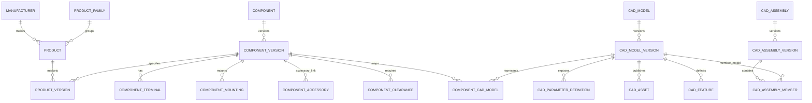
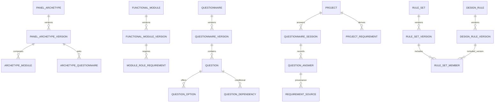
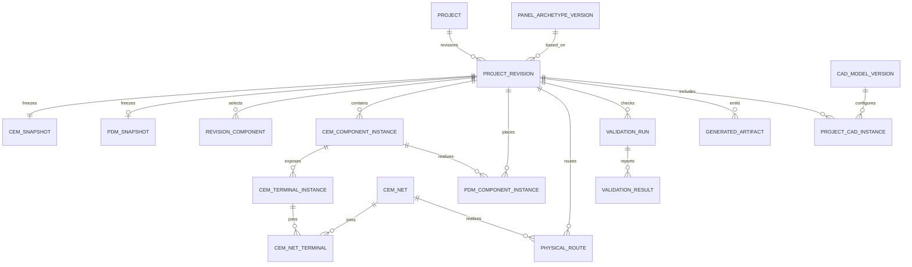

# Database blueprint

This document records the original database design. PostgreSQL runtime integration is now implemented; see [operations and development instructions](OPERATIONS.md) and [verification results](INTEGRATION_RESULT.md). JSON files under backend/app/data are retained as explicit import/test sources. The existing Pydantic CEM/PDM contracts and engineering services remain in use behind SQLAlchemy repositories.

## 1. Architecture

Use one PostgreSQL database initially, divided by naming/domain conventions rather than services or schemas. SQLAlchemy 2.x owns persistence mapping, Alembic owns forward-only schema migrations, and FastAPI/Pydantic validates API inputs. Catalog and template versions are immutable after publication. Project edits create a new project revision; published revision rows and snapshots are immutable. A revision pins every catalog, archetype, questionnaire, rule, CAD-model, and generator version used to calculate its outputs.

Structured, queried relationships live in relational rows: product identity, terminals, requirement links, electrical nets, placements, routes, and revision dependencies. JSONB holds category-specific specifications, parameter schemas/values, messages, and complete CEM/PDM snapshots. Revision creation inserts the revision header, snapshot, relational projections, validation records, and dependency edges in one transaction. A canonical snapshot hash plus projection rows from the same validated in-memory models makes drift detectable; never independently edit projection rows after snapshot commit. Rebuild projections transactionally from the snapshot or reject the revision.

Large CAD files stay in managed asset storage. The database holds immutable asset metadata, content hash, format, generator provenance, and a relative storage key. Local development can use an app data directory; a later storage adapter can map the same key to object storage without changing database references.

### PostgreSQL and SQLite

PostgreSQL is the target for multi-user deployments, JSONB querying/indexing, concurrent writers, robust constraints, and operational backups. SQLite is practical for a single-user offline desktop prototype and simpler packaging, but has one-writer concurrency, weaker JSON querying/index options, and different migration/locking behavior. Keep UUIDs, repository methods, JSON values, and transaction semantics portable. Use SQLAlchemy generic `Uuid` and `JSON` with a PostgreSQL `JSONB` variant. Keep PostgreSQL-only production DDL (partial indexes, `GIN`, `pgcrypto`) in explicit Alembic dialect branches; SQLite migrations need their own compatible DDL and SQLite batch mode for constraint changes. Do not claim identical enforcement: Pydantic validates typed values and units on both, while PostgreSQL adds stronger database checks.

## 2. ER diagrams

### Catalog and CAD

### Archetypes, requirements, questionnaires, rules

### Project, CEM, PDM, validation, outputs

## 3. Modeling decisions

### Relational data, JSON, and provenance

| Data | Storage decision | Why |
|---|---|---|
| IDs, codes, lifecycle, version numbers, foreign keys, timestamps | Columns + FK/unique/check constraints | Referential integrity and stable lookup |
| Manufacturer, product, component identity and frequently filtered electrical ratings | Columns/tables | Catalog search, selection and traceability |
| Terminals, terminal electrical role, mounting, accessory compatibility, clearances | Child tables | Repeating entities with independent identity and joins |
| Rare category-specific technical attributes | `specification JSONB` on immutable component version, with `schema_version` | Extensible; promote frequently queried/calculated attributes to typed columns |
| CAD parameter metadata | One row per parameter definition, with JSON allowed-values and default | Type/unit/required/indexable metadata and variable parameter sets |
| CAD parameter configured/evaluated values | JSON object per project CAD instance plus validation/evaluation metadata | Flexible evaluated values; validate against pinned definitions in Python |
| CEM/PDM complete snapshots | JSONB per immutable revision, with `schema_version`, hash | Reopen and regenerate historical revision exactly |
| CEM nets/terminals, placements, physical routes | Relational projections | Searchable and explicitly connected; do not hide topology in JSON |
| Rule configuration, evidence details, validation messages | Rule-version parameter JSON plus typed result status/keys and evidence JSON | Controlled engine dispatch; never execute arbitrary stored code |
| CAD and generated documents | Files in asset store; metadata rows in DB | Avoid large BLOBs, support local/object storage |
| Decision origin | `provenance` rows with source kind, source ID, actor, timestamp, notes | Audit human inputs, imported values, rules, optimizers, generators |

Use millimetres for geometry and explicit SI unit strings for other quantities. Quantities stored numerically are always paired with unit columns or typed parameter definitions. Store manufacturer nominal values separately from project overrides and evaluated outputs. No sample number in this blueprint is a verified product rating or safety threshold.

### Requirements and answers

Questionnaire responses are immutable session/answer records against a pinned questionnaire version. `project_requirements` are the normalized engineering inputs consumed by the engine (`code`, operator, typed value JSON, unit, resolution status). `requirement_sources` connects each requirement to one or more answer, imported specification, or engineer decision. The engine maps typed answers into requirements in application code; the DB does not treat a raw answer blob as the CEM.

### CEM electrical connectivity

Use explicit multi-terminal nets (`cem_nets` + `cem_net_terminals`) as the authoritative electrical topology. A two-ended connection can be represented as an optional segment/conductor record on a net for wire schedule attributes; do not model every multi-drop net as a set of pairwise edges. This matches graph algorithms while preserving net semantics. `cem_component_instances` point to immutable product/component versions and role codes; their terminal instances snapshot actual terminal names and references. Template role/terminal mappings are copied into instantiated CEM rows so later template edits cannot change an old revision.

### PDM and geometry

One logical CEM component may map to zero or more PDM component rows, allowing split physical representations while maintaining traceability. Store placement transform (translation in mm, quaternion orientation), parent/mounting relation, selected pinned CAD model version and parameter values. Rails, enclosure, ducts and clearance regions are explicit physical entities; routes refer to nets and store waypoint arrays in the project coordinate frame. Keep feature geometry and solids in CAD files/kernel. The database stores transforms, bounding boxes/envelopes needed for search or validation, and the snapshot—not BREP solids or mesh triangles.

### Parameters and CAD

`cad_parameter_definitions` are normalized per model version: code, scalar type, unit, editable/derived flag, defaults, bounds, allowed values, dependency/formula metadata. Formula strings are declarative expressions interpreted by a constrained evaluator, never Python `eval`. For purchased fixed-size products, dimension parameters are read-only; permit overrides only when the published model definition explicitly marks them editable. Project CAD instances pin a model version and persist supplied, derived, and final evaluated values, separately labeled in JSON.

Native `.FCStd` preserves FreeCAD feature history when the model was authored parametrically, but requires compatible FreeCAD/runtime and dependencies. STEP is a neutral solid exchange format and usually loses native feature history. GLB/glTF is a render/preview mesh, not a manufacturing-editable parametric source. JSON parameter/feature definitions are portable but need a versioned generator and constrained feature vocabulary. Assembly transforms and source-member links remain relational; the native assembly asset is a generated artifact.

An output is reproducible only if model/version, input parameter JSON, generator name/version, dependency versions, coordinate convention, and source hashes are pinned. Hash every asset with SHA-256, verify on read, and mark generation failed if a dependency is missing or its hash differs. Regeneration writes a new immutable artifact row rather than replacing an old file.

### Versioning, migration, and dependency invalidation

Published catalog/model/template/questionnaire/rule versions are insert-only. A correction or changed meaning creates a new version. A project revision pins the selected versions and stores CEM/PDM snapshots, schema versions, source revision, generator metadata, and a content hash. Reopening means loading that exact snapshot; branching creates a new revision with a `parent_revision_id`. Alembic migration revisions are forward-only, reviewed, and separate from engineering revision numbers. Data migrations are idempotent, record their own migration identifier, and preserve source JSON until migrated records are verified.

`revision_dependencies` stores typed dependency edges and input hashes (for example `project_parameter:enclosure.width_mm -> pdm:usable_area`). Each generated stage records a deterministic input hash. On change, invalidate only downstream nodes reachable from the changed node; do not reuse output when any recorded hash differs. This is complementary to, not a substitute for, the engine's existing change propagation graph.

### Validation responsibility

- SQL: identity, uniqueness, referential integrity, lifecycle/status enums/checks, nonnegative dimensions, and basic shape checks.
- Pydantic: API types, required fields, unit syntax, and local DTO consistency.
- Engineering engine: rating selection, compatibility, net topology rules, constraints/severity, dependency calculations, optimization, and traceable decisions.
- CAD kernel/geometry layer: solids, actual collisions, manufacturability geometry, feature build success.

Database checks cannot establish standards compliance, electrical safety, or collision freedom. Rule versions must include provenance and applicability; this blueprint defines no universal safety threshold.

## 4. Table inventory / data dictionary

The SQL files below define the baseline fields and constraints. In each table the `id` is UUID unless identified as a natural code. `created_at`/`updated_at` are UTC timestamps. JSON fields are explicitly versioned where they capture flexible schemas or snapshots. The first slice tables are marked **MVP**; remaining tables are prepared extension points and can be migrated in later domain phases.

| Domain | Tables and key contents | MVP? |
|---|---|---|
| Catalog | `manufacturers` (unique code/name), `product_families` (manufacturer-scoped code), `components` (stable engineering identity/category), `component_versions` (immutable specs, key ratings/dimensions/spec JSON), `products` (manufacturer SKU identity), `product_versions` (product-to-component-version, lifecycle/datasheet), `component_terminals`, `component_mounting`, `component_accessories`, `component_clearances`, `component_thermal_specs`, `component_documents` | manufacturers, components, component_versions, products, product_versions |
| CAD | `cad_models`, `cad_model_versions`, `cad_parameter_definitions`, `cad_features`, `cad_assets`, `component_cad_models`, `cad_assemblies`, `cad_assembly_versions`, `cad_assembly_members` | models, versions, parameters, assets, component mapping |
| Reusable patterns | `panel_archetypes`, `panel_archetype_versions`, `functional_modules`, `functional_module_versions`, `archetype_modules`, `module_role_requirements`, `archetype_defaults`, `electrical_templates`, `electrical_template_versions`, `archetype_electrical_templates`, `template_component_roles`, `template_terminals`, `template_connections` | archetypes + versions |
| Questions and requirements | `questionnaires`, `questionnaire_versions`, `questionnaire_sections`, `questions`, `question_options`, `question_dependencies`, `question_validation_rules`, `questionnaire_sessions`, `question_answers`, `project_requirements`, `requirement_sources`, `requirement_role_mappings` | requirements; questionnaire tables in slice |
| Rules | `rule_sets`, `rule_set_versions`, `design_rules`, `design_rule_versions`, `rule_set_members`, `rule_applicability`, `validation_runs`, `validation_results` | rule versions + validation |
| Project and CEM | `projects`, `project_revisions`, `revision_components`, `project_parameter_overrides`, `cem_snapshots`, `cem_component_instances`, `cem_terminal_instances`, `cem_nets`, `cem_net_terminals`, `cem_conductors` | projects, revisions, CEM snapshot, components/nets |
| PDM and trace | `pdm_snapshots`, `pdm_enclosures`, `pdm_mounting_structures`, `pdm_component_instances`, `pdm_placements`, `pdm_clearance_regions`, `pdm_routes`, `revision_dependencies`, `provenance` | PDM snapshot, enclosure/rails, placement, route |
| Output | `project_cad_instances`, `project_cad_assembly_instances`, `project_cad_assembly_members`, `generated_artifacts` | artifact |

The DDL includes PK/FK, checks, scoped natural-code uniqueness, and query-oriented indexes. Mutable drafts may be edited before a revision is published; immutable version/revision rows should be protected by repository policy and DB permissions in production. Hard-delete projects only under an explicit retention policy; use archive state for ordinary removal. Catalog versions and referenced project history use `RESTRICT`/no cascading deletes. Child rows of an unpublished draft may cascade when that draft is discarded.

## 5. Initial vertical slice

The initial usable scope is deliberately smaller than the full table inventory. Implement in this order:

1. Project and revision persistence with pinned archetype and requirements.
2. Minimal component/product catalog and enclosure/rail/duct product versions.
3. CEM snapshot and explicit component/terminal/net projections.
4. PDM snapshot with enclosure, rails, placements and routes.
5. Validation run/result and generated artifact metadata.
6. Local content-addressed file store and regeneration metadata.
7. Questionnaire authoring, richer module templates/rules, CAD assemblies, manufacturer documents, accessories, thermal/clearance and advanced dependency graph as follow-on migrations.

MVP tables: `manufacturers`, `components`, `component_versions`, `products`, `product_versions`, `panel_archetypes`, `panel_archetype_versions`, `projects`, `project_revisions`, `project_requirements`, `questionnaire_sessions`, `question_answers`, `cad_models`, `cad_model_versions`, `cad_parameter_definitions`, `cad_assets`, `project_cad_instances`, `generated_artifacts`, `cem_snapshots`, `cem_component_instances`, `cem_terminal_instances`, `cem_nets`, `cem_net_terminals`, `pdm_snapshots`, `pdm_enclosures`, `pdm_mounting_structures`, `pdm_component_instances`, `pdm_placements`, `pdm_routes`, `validation_runs`, `validation_results`, `revision_dependencies`, `provenance`.

## 6. Asset storage

Use an app-managed root such as `{app_data}/assets/sha256/ab/cd/<full-hash>.<ext>`. The key is relative (`sha256/ab/cd/...`), generated from the hash, and independent of workstation/user path. Store a temporary file while generating, calculate SHA-256, atomically move to the content-addressed key, then insert asset/artifact metadata in the same logical operation (storage and DB cannot share a physical transaction; failed DB registration leaves a discoverable orphan for cleanup). Verify hash when opening. Never overwrite an existing key. The row records `storage_backend`, `storage_key`, byte size, media type/format, hash, origin asset, model/revision, generator and status.

On missing/corrupt files, mark availability as missing/corrupt, preserve the metadata row, and offer regeneration from the pinned inputs or recovery from backup. Cleanup removes only unreferenced files after a grace period and audit. Later, implement a storage adapter mapping the same logical key to S3-compatible/object storage; upload before metadata commit and garbage-collect orphan objects. Avoid machine-specific absolute paths in durable rows.

## 7. Implementation roadmap

**Phase 0 — persistence boundary:** add SQLAlchemy/Alembic dependencies; define repository protocols matching existing repository methods; configure SQLite dev and PostgreSQL production engines; keep JSON repository implementations for fixture fallback.

**Phase 1 — vertical slice:** migrate project creation, catalog read, requirement write, generation, CEM/PDM snapshot save/load, artifact registration. Use a single transaction to publish a revision after the in-memory pipeline and validation succeed. Reopen by revision ID and regenerate only with pinned versions.

**Phase 2 — engineering catalog:** add manufacturer products/SKUs, typed electrical ratings, terminals, mounting and accessory constraints; add import provenance and document asset records.

**Phase 3 — reuse and rules:** add versioned archetypes/modules, connection templates, questionnaire sessions and rule sets; map answers to requirements in a deterministic service.

**Phase 4 — parametric CAD and dependency graph:** implement CAD parameter evaluation, asset integrity, assembly members, stage hashes, invalidation and regeneration status.

**Phase 5 — manufacturing outputs and operations:** BOM/wiring/terminal schedules, revision comparison, backups, retention, and multi-user PostgreSQL deployment.

## 8. Files and execution order

1. `001_core.sql` — PostgreSQL core schema and indexes.
2. `002_sample_data.sql` — clearly illustrative seed data and a small end-to-end project.
3. `003_example_queries.sql` — query patterns corresponding to the requested operations.
4. `python_persistence.md` — SQLAlchemy/Alembic/repository/Pydantic starter implementation.

Run `psql -v ON_ERROR_STOP=1 -f 001_core.sql <database>` and then optionally `psql -v ON_ERROR_STOP=1 -f 002_sample_data.sql <database>`. In deployment, translate these ordered files into reviewed Alembic revisions; do not use raw SQL files as an ongoing production migration mechanism.
